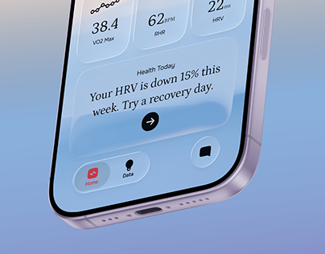

# Glass health tiles and serif recovery insight on a blue-violet gradient, thumbnail crop

**Discipline:** app · **Design type:** Device mockup scene
**Tags:** health, glass, serif, gradient, cropped-phone, thumbnail, insight, tab-bar

## What it is
A cropped lower half of a lavender phone on a blue-to-periwinkle gradient showing three glass tiles (38.4 VO2 Max, 62 BPM RHR, 22 ms HRV), a serif insight card 'Your HRV is down 15% this week. Try a recovery day.' with a black arrow and a floating tab bar with a pink Home pill.

## What it means
Calm and personal; serif sentences turn data into advice.

## Techniques
- Crop a phone to its lower half.
- Use frosted tiles for stats.
- Set insight text in serif.
- Highlight the active tab in a pink pill.

## Best for
- Health app thumbnails
- Insight cards
- Gradient mockups

## Vocabulary
- **Half-phone crop** — Showing only part of the device.
- **Insight sentence** — Advice written in plain language.
- **Floating tab bar** — A detached bottom nav.
- **Glass tile** — A translucent stat block.
