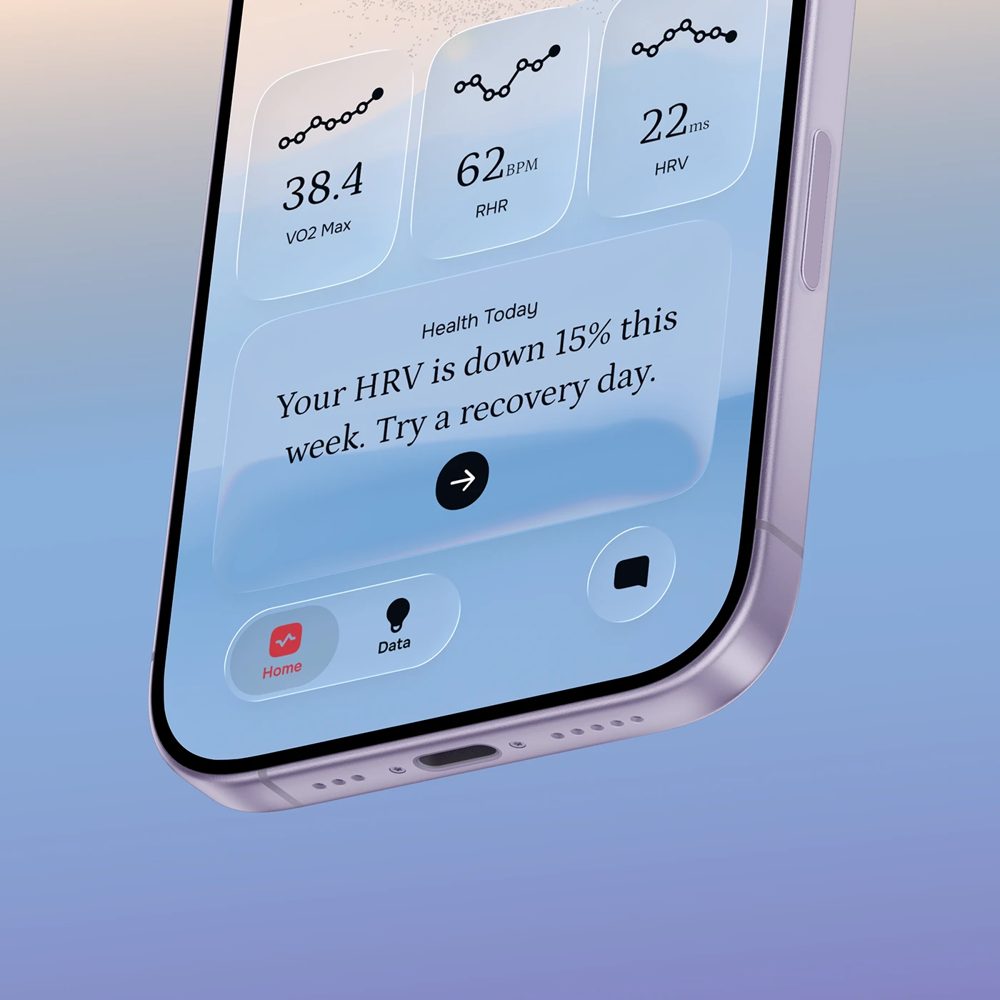

# Cropped phone corner with glass health tiles and a serif insight card on a blue-peach gradient

**Discipline:** app ·  · **Design style:** Glassmorphism
**Tags:** health, glass, serif, sparkline, gradient, crop, tilted, insight

## What it is
A tightly cropped lavender phone corner on a peach-to-periwinkle gradient. The screen shows three glass tiles with dotted sparklines (VO2 Max, RHR, HRV), an insight card in serif 'Your HRV is down 15% this week. Try a recovery day.' with a black arrow, and a floating tab bar.

## What it means
Calm and editorial; the serif sentence turns data into advice.

## Techniques
- Crop the device tightly to enlarge the UI.
- Set numbers in italic serif on glass tiles.
- Write the insight as a sentence.
- Float the tab bar as a glass pill.

## Best for
- Health and wellness apps
- Corner-crop showcases
- Insight-led interfaces

## Vocabulary
- **Corner crop** — Framing only a corner of a device.
- **Glass tile** — A translucent rounded tile.
- **Italic serif numerals** — Numbers set in an italic serif face.
- **Advice sentence** — A plain sentence interpreting data.
