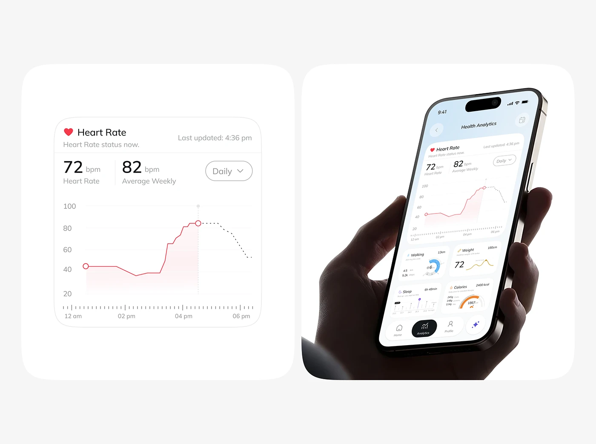

# Heart Rate Chart Component beside Analytics Phone

**Discipline:** app · **Design type:** UI components
**Tags:** heart-rate, chart, component, analytics, hand, white, red-line

## What it is
Two rounded white panels: one enlarging a heart rate card with a stepped red line chart, dotted forecast and time ruler, the other showing the same card in a hand-held analytics phone in a dark hand.

## What it means
Enlarging the component beside the phone shows detail and context together.

## Techniques
- Stepped line with a dotted projection
- Red marker dot at the current value
- Time ruler with tick marks under the chart
- Component shown large beside the full screen
- Dark hand against pale UI

## Best for
- Chart component showcases
- Health data visualisation
- Component-plus-context presentations

## Vocabulary
- **Dotted forecast** — A dotted continuation of a line showing a prediction.
- **Time ruler** — A tick-mark scale beneath a chart's time axis.
- **Component enlargement** — A UI piece shown large next to its screen.
