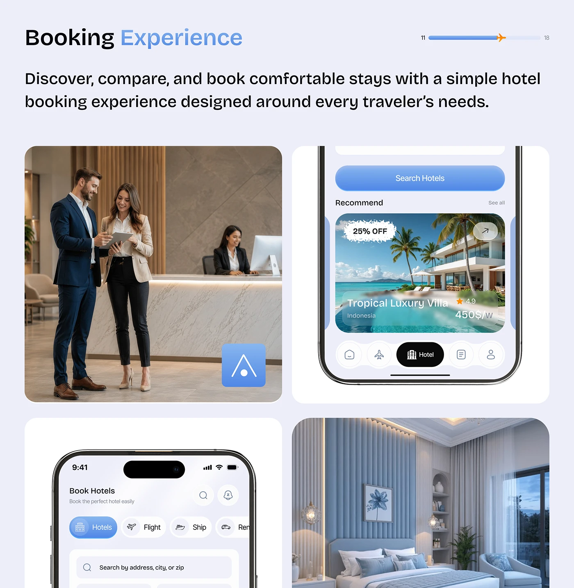

# Booking Experience Photo and Phone Quad

**Discipline:** app · **Design type:** Case study slide
**Tags:** hotel, booking, quad-grid, photography, lavender, progress-bar, blue

## What it is
A lavender slide titled Booking Experience with a plane progress bar, a paragraph and a 2-by-2 grid of rounded tiles: a hotel lobby photo with the app icon tile, a phone with a Recommend card and Hotel tab, a phone with a hotel search form and a blue bedroom photo.

## What it means
Alternating real photography and product tiles link the hotel world to the app in a calm blue palette.

## Techniques
- 2-by-2 grid alternating photo and phone tiles
- App icon tile overlaid on a photo
- Blue gradient search and torn discount sticker
- Photography colour-matched to the UI blue
- Progress bar with a plane marker

## Best for
- Booking experience slides
- Photo plus UI grids
- Hospitality app case studies

## Vocabulary
- **Quad grid** — A 2-by-2 layout of equal tiles.
- **Icon overlay** — An app icon placed on a photo as a brand stamp.
- **Palette-matched photo** — Photography chosen to share the UI's colour.
