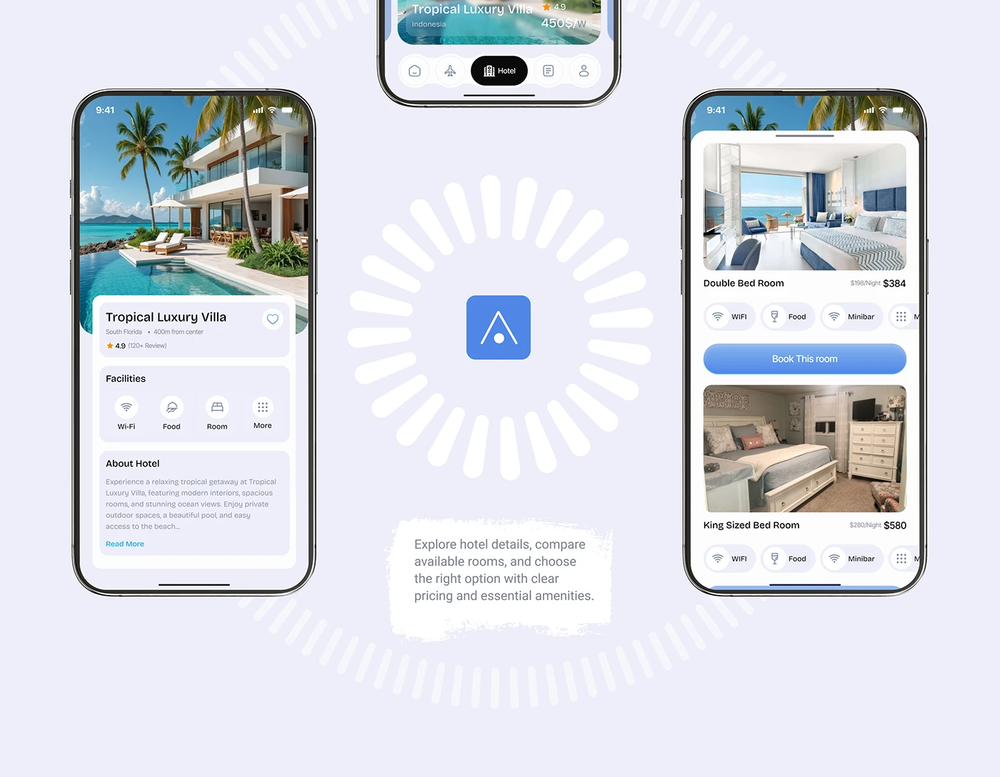

# Hotel Screens around a Sunburst Ring Logo

**Discipline:** app ·  · **Design style:** Playful & Illustrated
**Tags:** hotel, phones, ring, logo, brush-note, lavender, blue

## What it is
A lavender page with two phones (hotel detail and room list) flanking a centre logo tile inside a big ring of white rounded dashes like a sunburst, a third phone cropped at the top and a torn white note explaining the screens.

## What it means
The ring of dashes radiates from the logo like a sun, giving a static screen layout a pulse.

## Techniques
- Ring of radial dashes around a logo
- Flanking phones at equal heights
- Torn paper note under the logo
- Cropped extra phone at the top edge
- Blue primary buttons and pill chips

## Best for
- Hotel and booking case studies
- Radial compositions
- Logo-centred screen layouts

## Vocabulary
- **Radial dash ring** — Short strokes arranged in a circle radiating outward.
- **Centre logo** — A brand mark placed at the middle of a composition.
- **Facility chips** — Small pills listing amenities like Wi-Fi and food.
