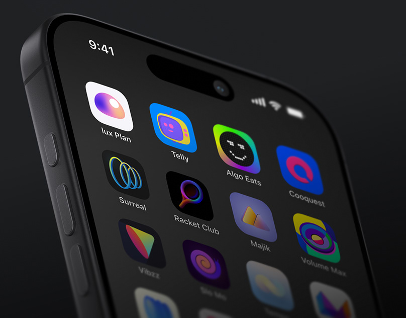

# Colourful gradient app icons on a dark home screen shown in perspective

**Discipline:** app · **Design type:** App icon showcase
**Tags:** app-icons, home-screen, dark, gradient, perspective, close-up, phone, icon-set

## What it is
An angled close-up of a black phone whose home screen shows a grid of varied gradient app icons (orbs, faces, spirals, geometric shapes) with white labels.

## What it means
Vibrant and inventive; each icon is a mini artwork, and the dark screen makes them glow.

## Techniques
- Show icons in context on a real home screen.
- Give each icon its own gradient, shape and personality.
- Use extreme perspective to make the grid dynamic.
- Keep the background dark and unfussy.

## Best for
- App icon design portfolios
- Icon set showcases
- Playful app brands

## Vocabulary
- **Icon grid** — A layout of app icons on a home screen.
- **Gradient icon** — An icon filled with a colour blend.
- **Perspective crop** — A close, angled view of a device.
- **Label text** — The small app name under each icon.
