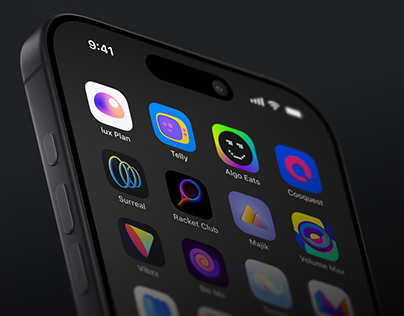

# Home-screen icon set, small thumbnail crop

**Discipline:** app · **Design type:** App icon showcase
**Tags:** app-icons, thumbnail, dark, gradient, perspective, phone, project-cover

## What it is
A smaller-format crop of the same angled dark phone displaying a grid of colourful gradient icons, used as a project thumbnail.

## What it means
Still legible at small size; bright icons on black keep instant appeal.

## Techniques
- Recrop tightly so icons fill the frame.
- Keep the top-left icon bright as the entry point.
- Preserve the dark background for contrast.
- Use the phone edge as a diagonal leading line.

## Best for
- Behance and Dribbble grid covers
- Social previews of icon work
- Portfolio thumbnails

## Vocabulary
- **Thumbnail recrop** — A version cropped for small display.
- **Diagonal edge** — A device edge used as a leading line.
- **Bright entry point** — The brightest element where the eye starts.
- **Dark stage** — A black background for colourful items.
