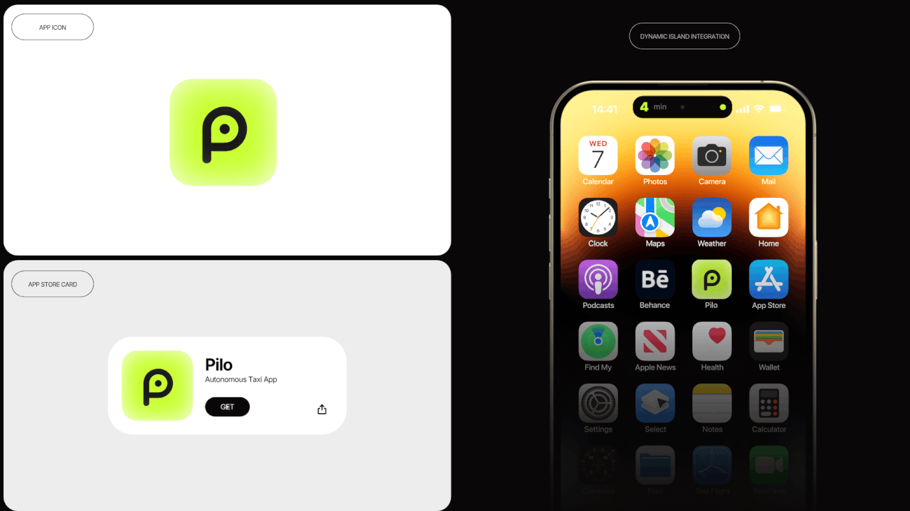

# Lime gradient P icon, App Store card and a phone home screen with a Dynamic Island timer

**Discipline:** app · **Design type:** App icon showcase
**Tags:** app-icon, store-card, dynamic-island, lime, black, home-screen, board, integration

## What it is
A board with a white panel showing a lime gradient rounded-square 'P' icon, a grey panel with an App Store card (icon, name, GET button), and a black panel with a phone home screen where the icon sits among system apps and the Dynamic Island shows a 4 min countdown with lime dot.

## What it means
Thorough and polished; the icon is proven in three real contexts.

## Techniques
- Show the icon big, in a store card and on a home screen.
- Integrate a live activity in the Dynamic Island.
- Label each panel with an outlined pill.
- Use lime gradient on the icon.

## Best for
- App icon presentations
- iOS integration showcases
- Brand boards

## Vocabulary
- **Dynamic Island** — iPhone pill area showing live activities.
- **Store card** — An app listing tile.
- **Icon in context** — An icon among real apps.
- **Live activity** — A real-time status shown on the lock or island.
