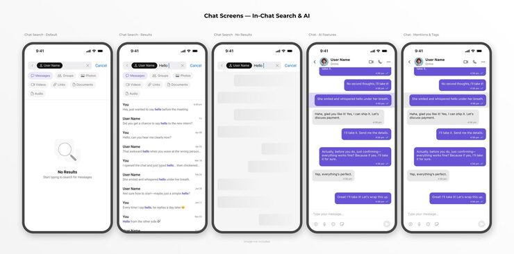

# Five chat screens: search default, results, no results, AI features and mentions

**Discipline:** app · **Design type:** Chat interface · **Design style:** Minimalist
**Tags:** chat, search, ai, filters, mobile, ui-kit

## What it is
Five phones titled 'Chat Screens — In-Chat Search & AI': a search with filter chips (Messages, Groups, Photos, Links) and a 'No Results' empty state, a results list with the term highlighted, a skeleton loading state, a thread with an AI-highlighted purple message, and a thread showing mentions and tags.

## What it means
Thorough and systematic; covering every search state shows a production-ready flow.

## Techniques
- Show default, results, loading and empty states side by side.
- Use filter chips under the search field.
- Highlight the matched term in results.
- Use skeleton rows for loading.

## Best for
- Chat apps
- Search UX documentation
- AI feature design

## Vocabulary
- **Skeleton screen** — Grey placeholder shapes shown while loading.
- **Filter chip** — A small toggle button narrowing results.
