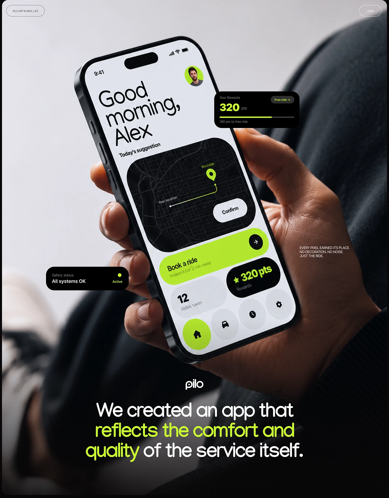

# Tilted hand-held app with 'Good morning, Alex' and floating black reward and status chips

**Discipline:** app · **Design type:** Device mockup scene
**Tags:** mobility, lime, black, hand, photo-blur, floating-chips, real-life, giant-type

## What it is
A photograph of a hand holding a tilted phone against a blurred dark sweater, the screen showing a huge greeting, a black map with a lime route and a 'Book a ride' lime bar. Black chips for rewards and safety status float outside, with a white headline below where the middle phrase is lime.

## What it means
Real and premium; the photo grounds the UI in everyday life.

## Techniques
- Shoot the device in a real hand with soft blur.
- Float black chips outside the screen for key facts.
- Colour the middle of a big statement lime.
- Fade the photo to black under the text.

## Best for
- App-in-real-life showcases
- Neon-accent mobility products
- Photo-plus-UI case study pages

## Vocabulary
- **In real life shot** — A UI shown in a real setting.
- **Floating chip** — A UI card placed outside the device.
- **Photo fade** — An image dissolving into black.
- **Greeting hero** — A big personalised hello as the screen's headline.
