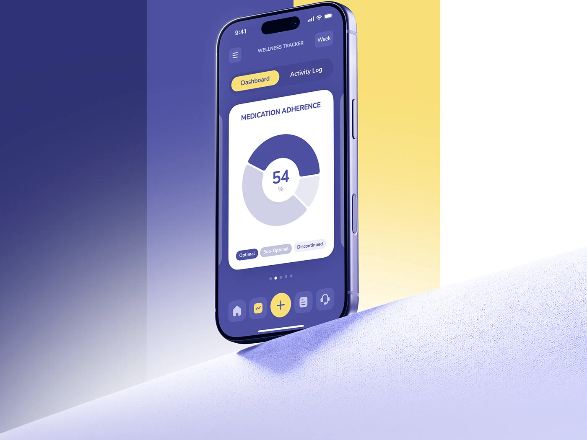

# Indigo Wellness Tracker on Lilac Fabric

**Discipline:** app · **Design type:** Device mockup scene
**Tags:** indigo, yellow, donut-chart, wellness, fabric, stripes, tilted

## What it is
A tilted indigo phone showing a medication adherence donut chart with a yellow plus button, standing on a lilac fabric ramp against vertical stripes of navy, indigo, yellow and white.

## What it means
Colour blocks behind the device match the app palette so the scene feels like part of the brand.

## Techniques
- Vertical colour stripes echoing the palette
- Textured fabric ledge for tactility
- Donut chart as the hero data
- Yellow as sole warm accent
- Device tilted with a soft shadow

## Best for
- Wellness and medication apps
- Brand-matched device scenes
- Colour-block hero images

## Vocabulary
- **Colour stripes** — Vertical bands of brand colours behind a subject.
- **Donut chart** — A ring chart showing proportions.
- **Fabric ledge** — A textile surface used as a stage.
