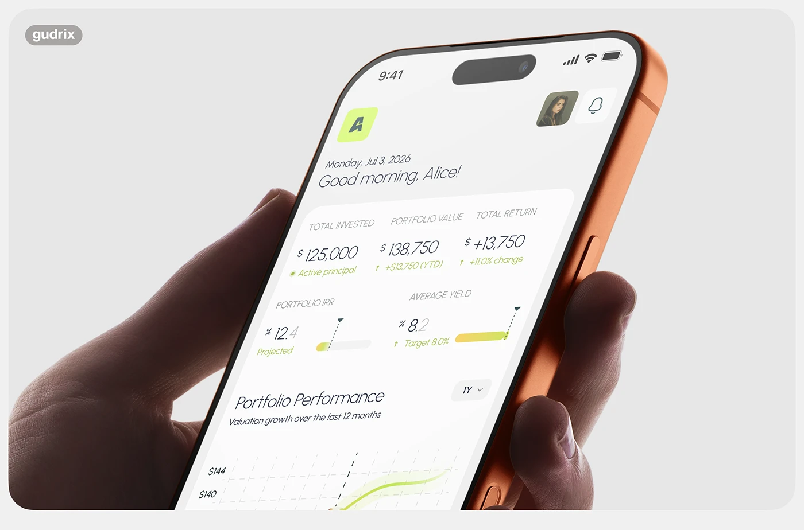

# Tilted close-up of an investing app in an orange phone held in a hand

**Discipline:** app · **Design type:** Device mockup scene
**Tags:** fintech, mockup, orange, hand, perspective, close-up, light-ui

## What it is
A rounded light-grey frame with a huge angled close-up of an orange phone in a hand. The screen shows a greeting, metrics, small yield bars and the start of a chart, in italicised perspective.

## What it means
Modern and tactile; the dramatic angle makes the interface feel alive and desirable.

## Techniques
- Use an extreme angled close-up to make text swoop across the frame.
- Pick a phone colour that complements the UI accent.
- Crop the device to fill the frame.
- Frame the shot in a rounded card with a small studio tag.

## Best for
- Case-study covers
- Fintech and lifestyle app showcases
- Detail shots in portfolios

## Vocabulary
- **Perspective crop** — A close, angled view where the screen recedes.
- **Complementary hardware** — A phone colour chosen to complement the UI.
- **Rounded frame** — A card-shaped container around a project image.
- **Studio tag** — A small label with a designer's name.
