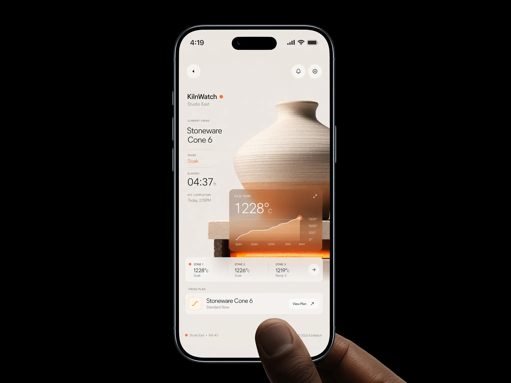

# Kiln monitoring app with photographed pot and terracotta glass card

**Discipline:** app ·  · **Design style:** Warm & Organic
**Tags:** monitoring, craft, warm-neutral, terracotta, glass-card, hand-held, black-backdrop, photography

## What it is
A phone on a black background, held by a thumb, shows a warm off-white screen. A photo of a ceramic vase with a glowing kiln beneath fills the middle; a translucent terracotta card overlays it with a large temperature and a line chart. Info rows below list zones and the firing plan.

## What it means
Refined and calm, crafted like a studio tool; photography gives data an emotional context.

## Techniques
- Embed a real photograph of the monitored object into the UI.
- Overlay a tinted glass card whose colour comes from the photo.
- Set large light temperature numerals with tiny caps labels.
- Use one hot orange for state indicators.
- Present on black so the device glows.

## Best for
- Craft, maker and industrial monitoring apps
- Apps that connect data to physical objects
- Premium hardware companions

## Vocabulary
- **Tinted glass card** — A translucent card coloured to match the imagery under it.
- **Object photography UI** — Using a photo of the real subject inside an interface.
- **Caps label** — Tiny uppercase text naming a value.
- **Status dot** — A small coloured dot showing live state.
