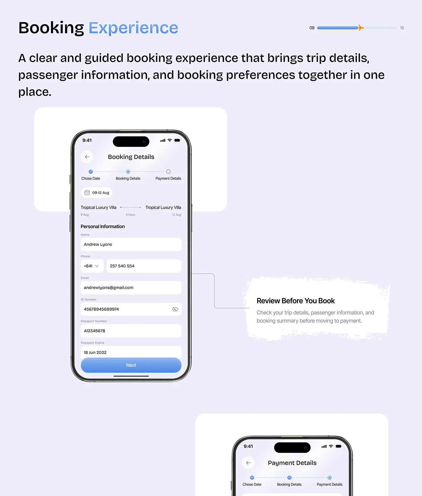

# Booking Form with Brush-Note Callout

**Discipline:** app · **Design type:** Travel app screens
**Tags:** booking, form, lavender, brush-stroke, callout, stepper, travel

## What it is
A lavender slide, Booking Experience, with a large phone showing a personal-information form under a three-step tracker, a torn white brush note 'Review Before You Book' linked by a thin line, and another phone peeking below.

## What it means
Connector lines and a hand-torn note explain a form's purpose without cluttering the UI.

## Techniques
- Elbow connector line from the phone to a callout
- Torn-paper note as annotation
- Progress tracker dots at the top of the flow
- Rounded white inputs on soft lilac
- Second device cropped at the bottom to imply a sequence

## Best for
- Form and checkout flow documentation
- Case-study feature explanations
- Travel and booking apps

## Vocabulary
- **Connector callout** — A line linking a UI area to an explanatory note.
- **Torn note** — A rough-edged paper shape used as an annotation.
- **Stepper** — A visual showing the current step in a multi-step flow.
