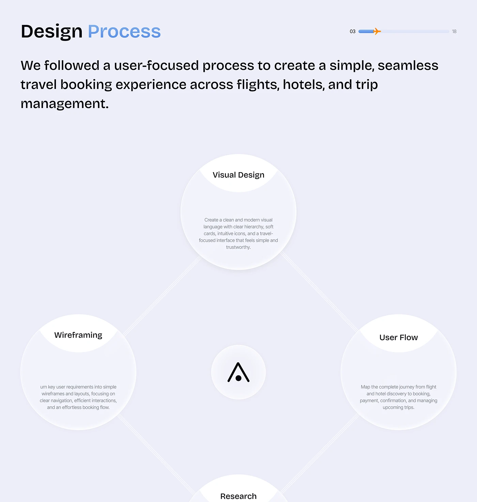

# Design Process in Four Circles

**Discipline:** app · **Design type:** Process slide
**Tags:** process, circles, diamond, lavender, logo, progress-bar, neumorphic

## What it is
A lavender slide titled Design Process with a plane progress bar and four large soft circles arranged in a diamond around a centre logo: Visual Design, Wireframing, User Flow and Research, each with a title on a white cap and a short description, joined by faint double lines.

## What it means
A diamond of soft circles makes a process feel cyclical and complete, and the logo at the centre ties it to the brand.

## Techniques
- Four circles at the corners of a diamond
- Logo in a small circle at the centre
- Titles on white segments at the top of each circle
- Faint connecting lines
- Soft neumorphic shadows

## Best for
- Process and methodology slides
- Cyclical workflows
- Soft-toned case-study documentation

## Vocabulary
- **Diamond layout** — Four items placed at the points of a diamond.
- **Neumorphic circle** — A soft-shadowed circle that looks gently raised.
- **Centre badge** — A logo at the middle of a diagram.
