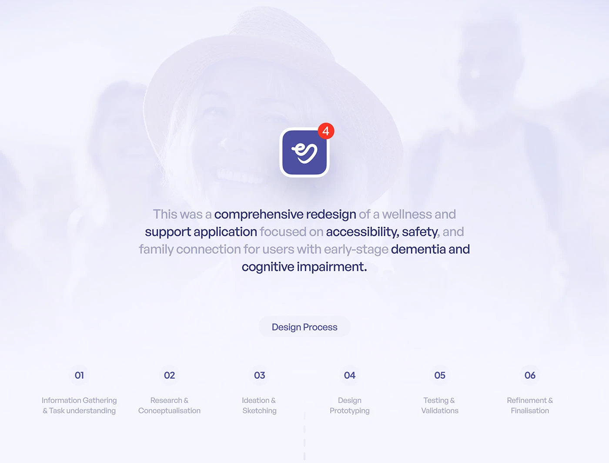

# Faded Photo Overview and Six-Step Process

**Discipline:** app · **Design type:** Design process showcase
**Tags:** overview, app-icon, lavender, faded-photo, process, numbers, tone-shift

## What it is
A pale lavender slide with a heavily faded portrait behind a centred indigo app icon with a red badge, a paragraph with phrases in dark navy and light grey, a Design Process pill and six numbered stages in a row.

## What it means
A ghosted human photo keeps the focus on the icon while adding warmth, and the six-step row summarises the process at a glance.

## Techniques
- Faded photo as an atmospheric backdrop
- App icon with notification badge as the centrepiece
- Bold key phrases inside a grey paragraph
- Numbered steps in a single row
- Dashed line dropping toward the next section

## Best for
- Project overview slides
- Care and wellness case studies
- Process summaries with numbered steps

## Vocabulary
- **Ghost photo** — A photo lightened until it becomes a texture.
- **Notification badge** — A small red circle with a count on an icon.
- **Process row** — Numbered stage labels laid out horizontally.
