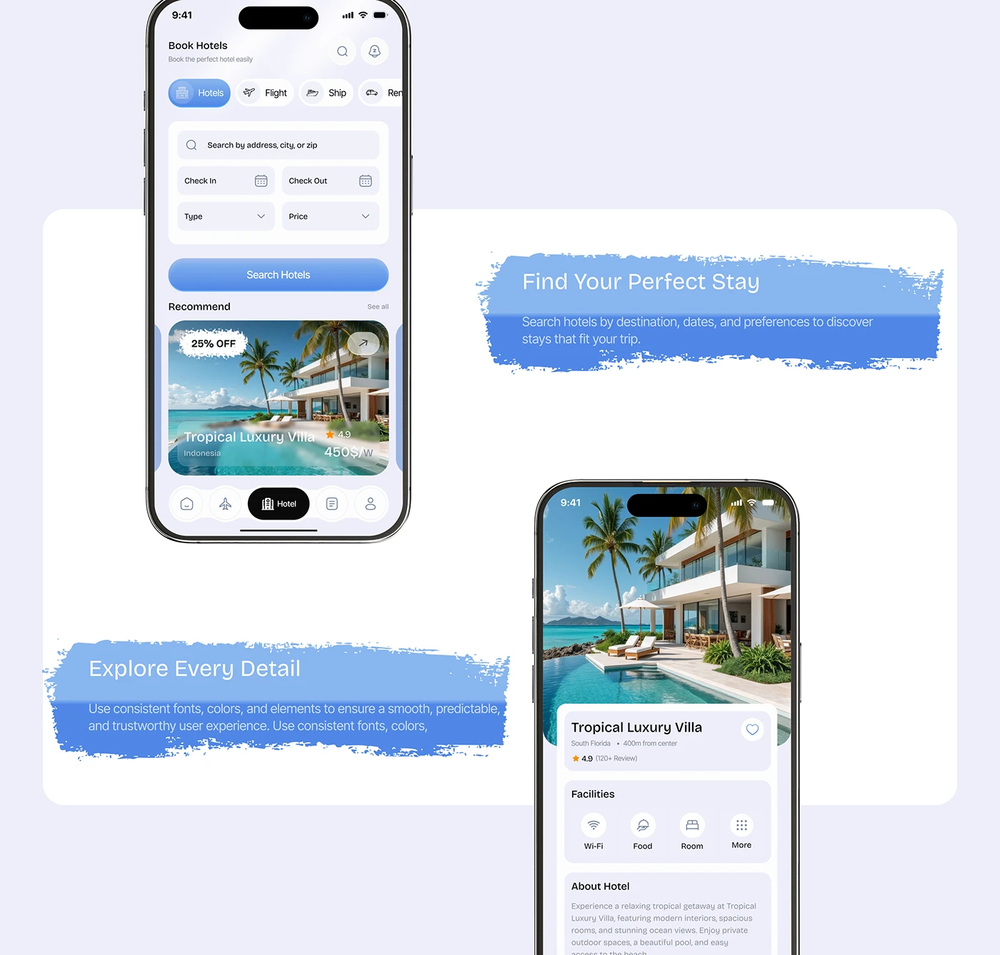

# Hotel App with Brush-Stroke Callouts

**Discipline:** app ·  · **Design style:** Gradient & Aurora
**Tags:** hotel, lavender, brush-stroke, callout, blue, phones, feature

## What it is
Two phones (hotel search and villa detail) on a lavender panel, each accompanied by a rough blue paint-stroke banner with a feature headline and description.

## What it means
The rough paint strokes contrast with the polished UI, adding a human, hand-made energy to a feature explanation.

## Techniques
- Painted blue swash as a text background
- Two-tone gradient inside the brush stroke
- Phones offset diagonally to create flow
- Same blue as the UI buttons for cohesion
- White rounded panel on a lavender field

## Best for
- Feature highlights in case studies
- Travel and hospitality apps
- Softening a very clean interface

## Vocabulary
- **Brush swash** — A rough painted stroke used behind text.
- **Feature callout** — A headline and short description attached to a screen.
- **Diagonal offset** — Placing items along a diagonal to create movement.
