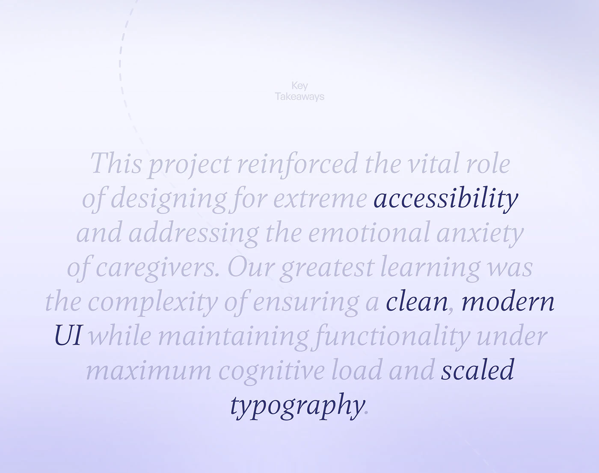

# Key Takeaways in Italic Serif

**Discipline:** app · **Design type:** Case study closing slide
**Tags:** takeaways, italic-serif, lavender, highlight, centered, dashed-arc, text-only

## What it is
A pale lavender gradient slide with a tiny Key Takeaways label, a centred italic serif paragraph in pale grey-lilac where key words (accessibility, clean modern UI, scaled typography) are dark navy, and a faint dashed arc at left.

## What it means
Only the important words are dark, so the paragraph can be skimmed, and the italic serif feels reflective.

## Techniques
- Pale text with dark highlighted key words
- Centred italic serif paragraph
- Tiny label above
- Faint dashed arc as decoration
- Soft lavender gradient

## Best for
- Case-study reflections
- Key takeaway slides
- Text-only closing slides

## Vocabulary
- **Key word emphasis** — Setting only selected words in a darker tone.
- **Italic serif** — A slanted serif typeface giving an editorial voice.
- **Reflection slide** — A slide summarising what was learned.
