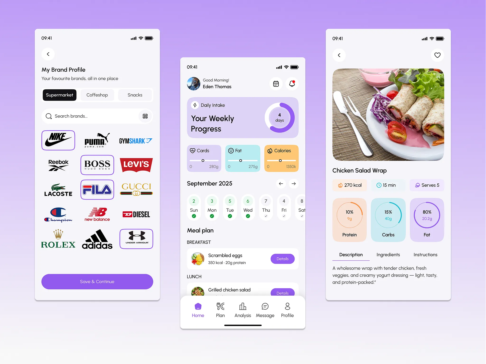

# Three white screens on lavender: brand profile grid, weekly meal plan with pastel macro cards, and recipe detail with rings

**Discipline:** app · **Design type:** Health app screens
**Tags:** nutrition, lavender, purple, pastel-cards, rings, logo-grid, calendar, phones

## What it is
Three phones on a lavender gradient: a brand profile with pill tabs, search and a 3x3 grid of brand logos with three selected, a home with a purple progress card and ring, tinted macro cards (lilac, mint, peach), a date strip with check marks and a meal plan list, and a recipe with a photo, stat chips, three ring cards and tabs.

## What it means
Friendly and clear; pastel colour-coded cards make nutrition data feel gentle.

## Techniques
- Colour-code macros with three pastel tints.
- Use ring charts inside tinted cards.
- Show a week as a check-mark strip.
- Keep one purple for actions.

## Best for
- Nutrition and meal-planning apps
- Pastel colour-coded UI
- Selectable logo grids

## Vocabulary
- **Macro card** — A tinted card showing a nutrient value.
- **Ring chart** — A circular progress chart.
- **Date strip** — A row of days with completion marks.
- **Selectable logo grid** — Brand logos with highlighted chosen ones.
