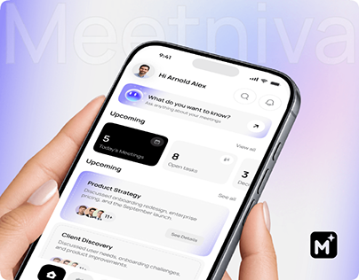

# Lavender Meeting Assistant in Hands

**Discipline:** app ·  · **Design style:** Geometric & Bauhaus
**Tags:** lavender, hands, meetings, ai, ghost-type, cards, cover

## What it is
A cover with hands holding a phone showing a meeting assistant home (AI greeting, upcoming meetings, task counts) on a white and lavender gradient with faint 'Meetniva' lettering and a logo tile.

## What it means
Soft lavender and rounded cards make a work tool feel calm rather than corporate.

## Techniques
- Black card for today's meetings as a strong contrast
- Lavender gradient cards for upcoming items
- Ghost brand name behind the phone
- Hands entering from left and right
- Logo tile bottom right

## Best for
- Productivity and AI meeting tools
- Case-study covers
- Soft-toned workplace apps

## Vocabulary
- **Contrast card** — A dark card among light ones to mark the primary item.
- **AI greeting** — An assistant prompt card at the top of a home screen.
- **Ghost lettering** — Oversized faint brand text behind a subject.
