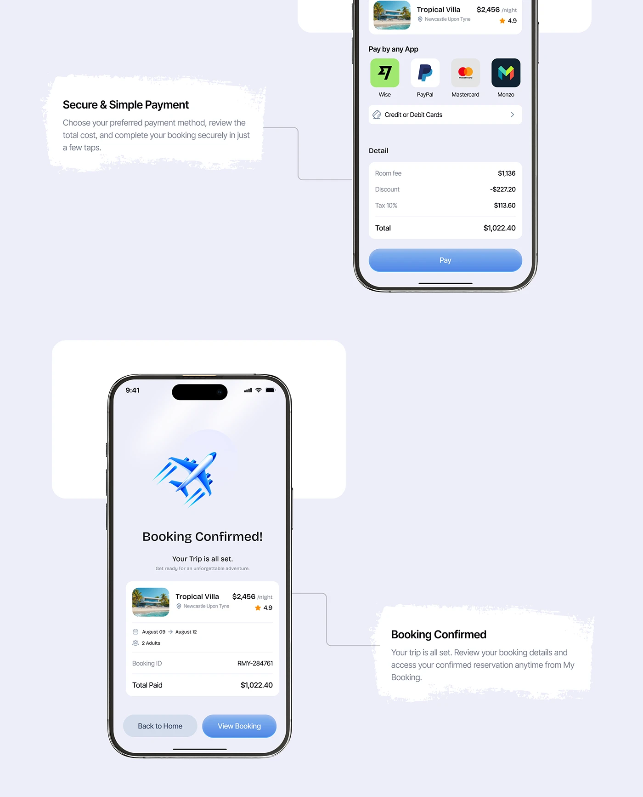

# Payment and Booking Confirmed with Brush Notes

**Discipline:** app ·  · **Design style:** 3D & Surreal
**Tags:** payment, confirmation, lavender, brush-notes, connectors, plane, blue

## What it is
A lavender page with a payment phone cropped at the top (pay-by-app icons, fee breakdown and a blue Pay button), a booking confirmed phone with a 3D plane and a summary card, and two brush-stroke white notes joined to the phones by elbow connector lines.

## What it means
Connectors from torn notes to the screens explain each step, and a 3D plane makes confirmation a celebration.

## Techniques
- Torn paper notes linked by connector lines
- 3D plane icon as the confirmation reward
- Payment app icons in rounded tiles
- Cropped top phone implying scroll
- Blue gradient primary and grey secondary buttons

## Best for
- Payment and confirmation screens
- Annotated screen presentations
- Travel apps

## Vocabulary
- **Brush note** — A rough torn-paper shape holding an annotation.
- **Reward icon** — A celebratory 3D illustration on a success screen.
- **Fee breakdown** — A list showing room fee, discount, tax and total.
