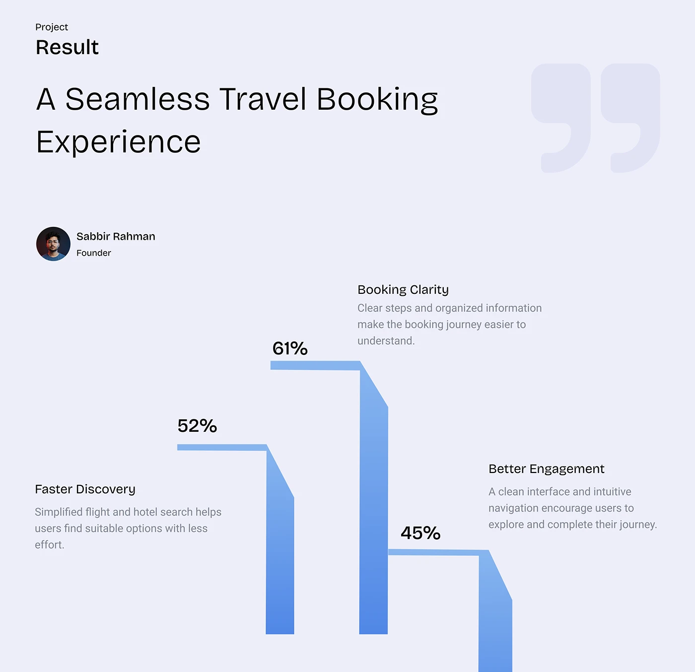

# Project Result with Stepped Percent Bars

**Discipline:** app ·  · **Design style:** Gradient & Aurora
**Tags:** results, stats, stepped-bars, lavender, quote-mark, blue, travel

## What it is
A lavender slide with 'Project Result', a headline about a seamless travel booking experience, a giant faint quote mark, a founder avatar and three blue gradient bars with angled shoulders and percentages 52, 61 and 45 with captions.

## What it means
The stepped bars turn results into a bold graphic skyline, and captions sit beside each for clarity.

## Techniques
- Bars with an angled shoulder as a stylised bar chart
- Percentages placed at the top of each bar
- Captions placed beside the bars at alternating heights
- Giant faint quote mark as decoration
- Blue gradient fading light to dark

## Best for
- Results slides
- Testimonial-led metrics
- Simple three-stat visuals

## Vocabulary
- **Stylised bar** — A bar chart element given a custom, graphic shape.
- **Stat caption** — A short heading and sentence explaining a number.
- **Quote watermark** — A huge faint quotation mark used as decoration.
