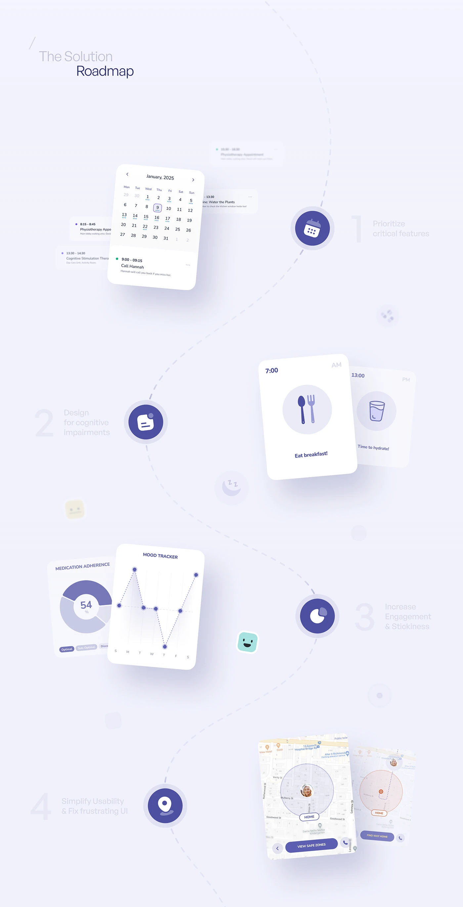

# Solution Roadmap on an S-Curve Path

**Discipline:** app ·  · **Design style:** Minimalist
**Tags:** roadmap, s-curve, indigo, lavender, floating-cards, calendar, icons

## What it is
A tall lavender sheet titled The Solution Roadmap with a dashed S-curve connecting four indigo icon nodes with ghost numerals and goals, each paired with floating UI cards (calendar, meal reminders, medication and mood charts, safe-zone map).

## What it means
The winding path makes a list of goals feel like a journey, and each goal shows its UI as proof.

## Techniques
- Dashed S-curve linking round icon nodes
- Ghost numerals beside each goal
- Floating UI cards beside every node
- Alternating left and right placement
- Single indigo hue with pastel accents

## Best for
- Solution roadmap slides
- Feature-to-goal mapping
- Long-scroll case studies

## Vocabulary
- **Roadmap path** — A curved line joining goals in sequence.
- **Icon node** — A circular icon marking a stop on a path.
- **Ghost numeral** — A large faint number beside a heading.
