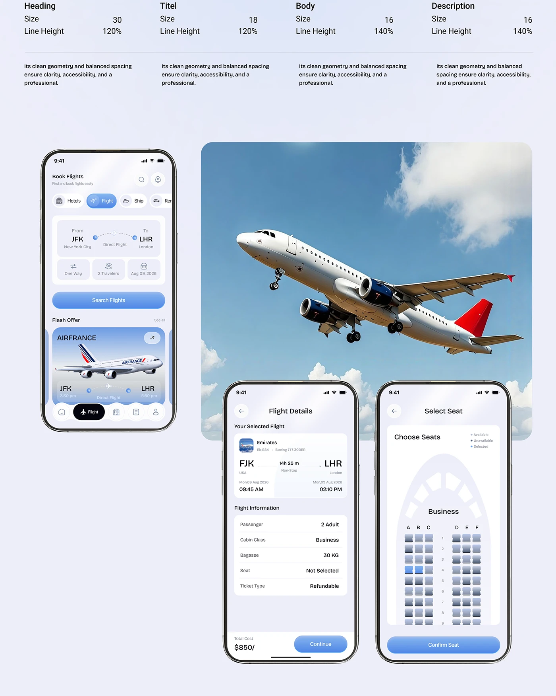

# Type Scale, Flight Screens and Airplane Photo

**Discipline:** app ·  · **Design style:** Neo-Brutalist
**Tags:** typography, flight, airplane, lavender, blue, screens, seat-map

## What it is
A lavender page with a four-column type scale (Heading, Title, Body, Description) above three phones (flight search, flight details, seat selection) and a large airplane photo behind the lower phones.

## What it means
Pairing spec text with real screens and a dramatic photo keeps documentation lively and on theme.

## Techniques
- Type spec rows above the visuals
- Large photo tile behind overlapping phones
- Blue gradient buttons across screens
- Seat map drawn in an aircraft outline
- Uniform bezel style

## Best for
- Travel app documentation
- Case-study system sections
- Flight booking flows

## Vocabulary
- **Type spec row** — Sizes and line heights listed per text role.
- **Seat map** — A diagram of selectable seats in a vehicle.
- **Overlap collage** — Devices overlapping a large image.
