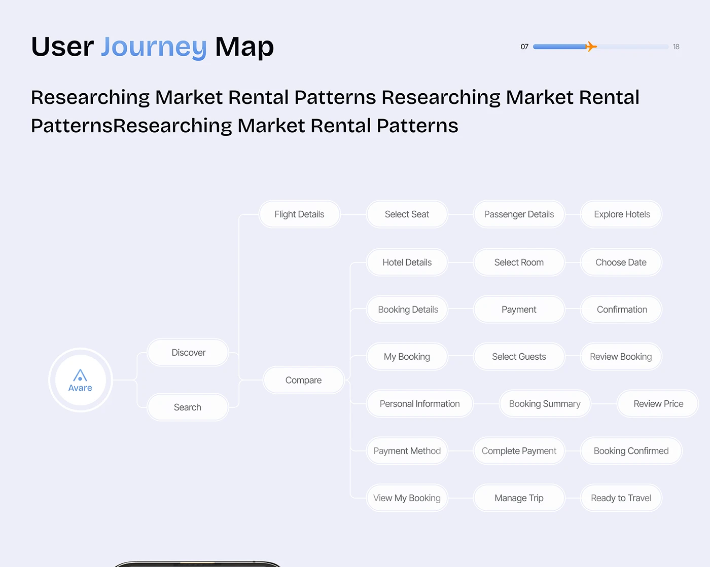

# Lavender User Journey Node Map

**Discipline:** app · **Design type:** UX documentation
**Tags:** user-journey, nodes, lavender, pills, tree, progress-bar

## What it is
A lavender slide, User Journey Map, with a plane-topped progress bar and a left-to-right tree of white pill nodes from the logo through Discover, Search and Compare to booking, payment and travel steps.

## What it means
Soft pill nodes make a complex flow feel light, and the tree layout shows branching clearly.

## Techniques
- Logo as the root node in a circle
- White pill nodes with soft shadows
- Thin elbow connectors
- Aligned columns for consistent steps
- Progress bar with plane marker

## Best for
- User flow documentation
- App architecture slides
- Booking journeys

## Vocabulary
- **Journey map** — A diagram of the steps a user takes.
- **Elbow connector** — A right-angled line linking nodes.
- **Root node** — The starting item of a tree.
