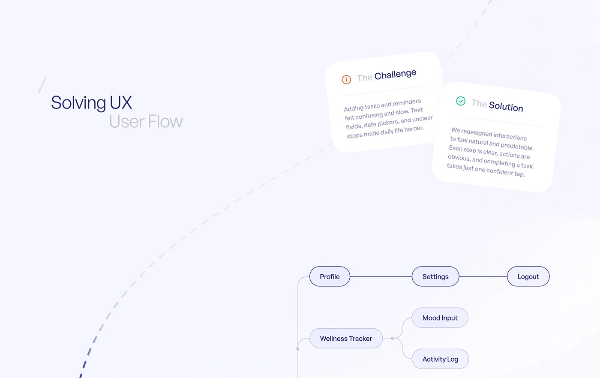

# Lavender UX Flow with Challenge and Solution Cards

**Discipline:** app · **Design type:** UX documentation
**Tags:** lavender, user-flow, ux, dashed-line, cards, tilted

## What it is
A case-study slide with a soft lavender field, a title in two weights, tilted Challenge and Solution cards, a dashed arc and a rounded node flow diagram.

## What it means
Soft tone and gentle tilts make a UX explanation feel friendly. The paired cards deliver the story at a glance.

## Techniques
- Two-weight title where the second line is faded
- Tilted overlapping cards with icon status marks (warning, check)
- Dashed curved line to lead the eye
- Pill-shaped nodes joined by thin connectors
- Very low-contrast background

## Best for
- UX case studies
- Explaining a problem and its fix
- Wellness and productivity app portfolios

## Vocabulary
- **Challenge/solution pair** — Two adjacent cards contrasting a problem with its answer.
- **User flow diagram** — A map of screens or steps a person moves through.
- **Faded second line** — A title's second line set in a lighter tone.
