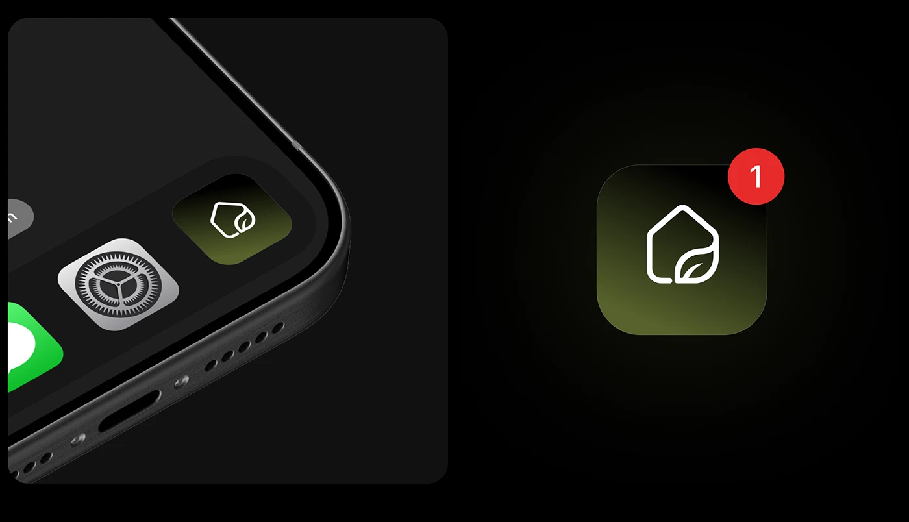

# Leaf-House App Icon with Badge

**Discipline:** app ·  · **Design style:** Gradient & Aurora
**Tags:** app-icon, dark, olive, gradient, badge, line-icon, close-up

## What it is
Two dark panels: a phone corner with the icon beside Settings and Messages, and a huge version of the icon, an olive-gradient rounded square with a white house-and-leaf line mark and a red '1' badge.

## What it means
A single line mark on a moody olive glow feels natural and calm, and the red badge shows it alive in a real context.

## Techniques
- Simple outlined mark merging two ideas (house and leaf)
- Olive gradient fading to near-black in the icon tile
- Close-up device crop beside familiar system icons
- Red notification badge as a realism cue
- Soft radial glow behind the enlarged icon

## Best for
- App icon design
- Smart-home and eco brands
- Dark-mode brand presentations

## Vocabulary
- **Notification badge** — A small red circle with a count on an icon.
- **Line mark** — A logo drawn with a single stroke weight.
- **Radial glow** — Light spreading from a center point into darkness.
