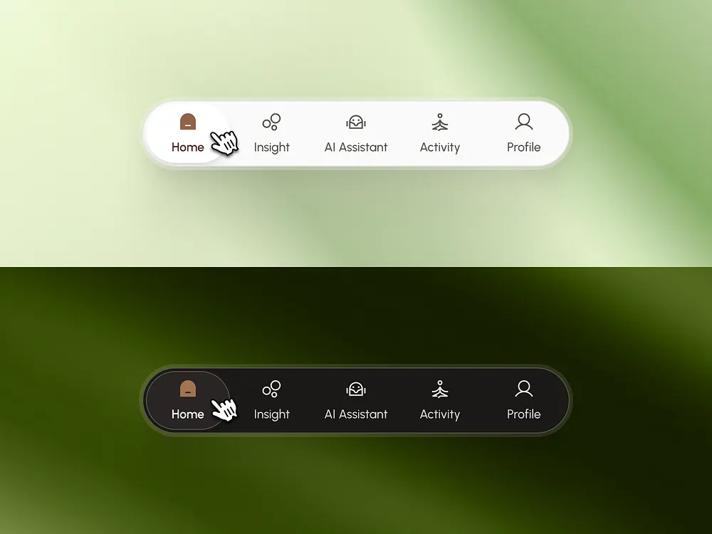

# Light and Dark Floating Tab Bar

**Discipline:** app · **Design type:** UI components
**Tags:** tab-bar, navigation, green, blur, light-dark, icons, hover

## What it is
Two versions of a pill navigation bar (Home, Insight, AI Assistant, Activity, Profile) on blurred green backgrounds, one white and one charcoal, with a pointer cursor over the active tab.

## What it means
Showing light and dark side by side proves theme flexibility, and the blurred foliage tones keep it soft and natural.

## Techniques
- Pill container with the active tab as an inner pill
- Thin monoline icons with short labels
- Blurred green photograph as ambient backdrop
- Mirrored light and dark variants stacked
- Cursor shown to imply interaction

## Best for
- Mobile navigation design
- Wellness and health apps
- UI component showcases

## Vocabulary
- **Active pill** — A highlighted rounded shape behind the selected tab.
- **Theme pair** — Light and dark variants of a component shown together.
- **Ambient blur** — An out-of-focus photo used as a color backdrop.
