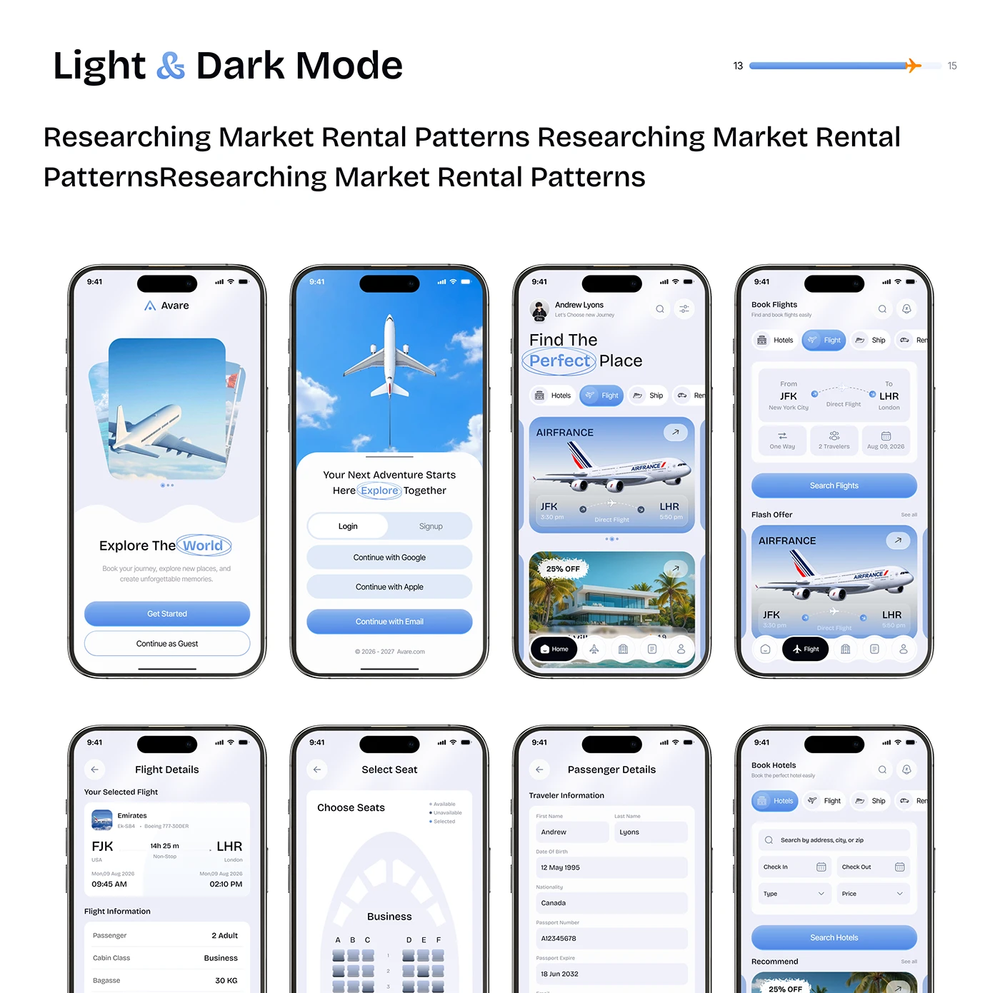

# Eight-Screen Travel Flow Sheet

**Discipline:** app · **Design type:** Travel app screens
**Tags:** screen-sheet, travel, blue, circled-word, onboarding, booking, seat-map

## What it is
A white slide titled Light & Dark Mode with a plane progress bar and two rows of four phones: splash, login, home, flight search, flight details, seat selection, passenger details and hotel search, in soft blue gradients with circled headline words.

## What it means
A uniform grid of screens with identical bezels shows a complete flow with one visual language.

## Techniques
- Two rows of four identical phones
- Circled words inside headlines
- Blue gradient primary buttons
- Airplane photography in cards
- Tiled layout cropped at the bottom

## Best for
- Full-flow screen sheets
- Travel app case studies
- Design-system consistency showcases

## Vocabulary
- **Screen grid** — Many app screens tiled with equal spacing.
- **Circled word** — A hand-drawn ellipse around a headline word.
- **Bezel uniformity** — Using identical device frames for every screen.
