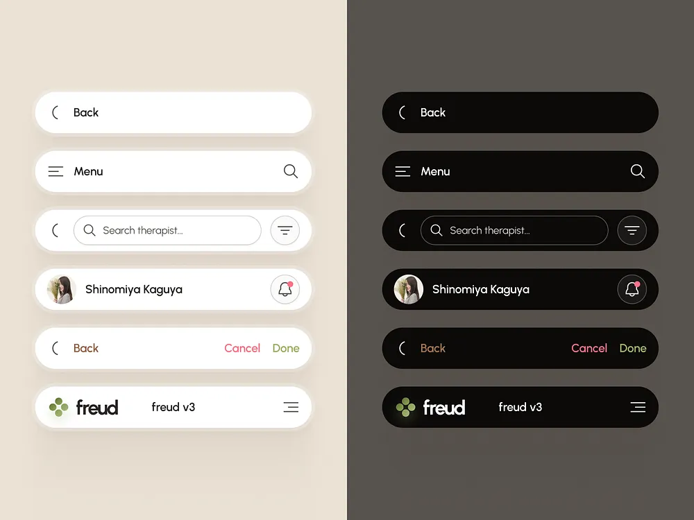

# Light and Dark Pill Header Components

**Discipline:** app ·  · **Design style:** Dark & Neon
**Tags:** header, navigation, pill, light-dark, search, avatar, components

## What it is
A split image of six pill-shaped header bars in a cream and white version on the left and black on a taupe field on the right: back, menu with search, search with filter, profile with a notification bell, back with cancel and done, and a logo with a menu icon.

## What it means
The paired themes show the system's flexibility, and the pill shape keeps every header friendly and consistent.

## Techniques
- Same components in light and dark side by side
- Pill-shaped containers with soft shadows
- Coloured text actions (pink cancel, green done)
- Small notification dot on the bell
- Logo with a soft glow in the dark version

## Best for
- Navigation component showcases
- Light and dark theme demonstrations
- Mobile header libraries

## Vocabulary
- **Pill header** — A rounded capsule holding navigation controls.
- **Theme pair** — Light and dark versions of a component shown together.
- **Text action** — A coloured word button such as Cancel or Done.
