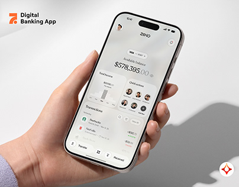

# Light Banking App in a Hand with Long Shadow

**Discipline:** app ·  · **Design style:** Minimalist
**Tags:** banking, light, hand, shadow, cover, logo, minimal

## What it is
A cover with a hand holding a phone showing a pale banking home with a large balance, income card and quick-action avatars, against a soft grey wall with a cast shadow, with a title and logo at the corners.

## What it means
Soft light and shadow make a quiet, premium mood, and the hand keeps it human.

## Techniques
- Natural window shadow across the wall
- Pale grey UI matching the scene
- Lilac cuff as a small colour note
- Logo mark and title top-left
- Diamond emblem bottom right

## Best for
- Banking app covers
- Soft lifestyle mockups
- Case-study openers

## Vocabulary
- **Cast shadow** — A shadow thrown onto a wall or surface.
- **Quick actions** — A row of shortcuts to common tasks.
- **Tonal UI** — An interface in the same pale tones as its surroundings.
