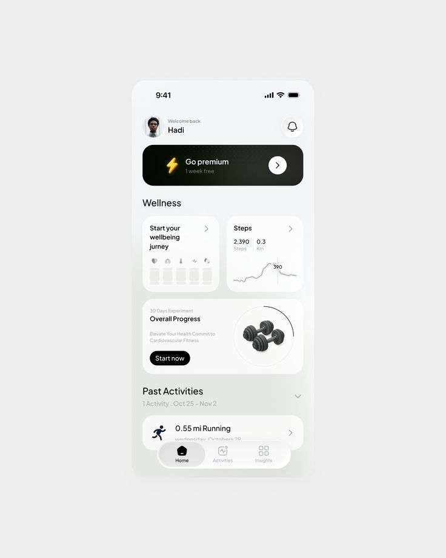

# Light Wellness Home with Premium Banner

**Discipline:** app · **Design type:** Health app screens
**Tags:** fitness, wellness, light, grey, cards, dumbbells, premium, minimal

## What it is
A single phone screen floating on a pale grey field showing a welcome greeting, a black Go premium banner with a bolt icon, Wellness cards for a journey and steps with a line chart, an Overall Progress card with a 3D dumbbell in a ring and a Start now button, a Past Activities row and a floating pill tab bar.

## What it means
Soft white cards on grey with one black banner and one black button make a calm hierarchy with clear actions.

## Techniques
- One black banner as the premium call to action
- 3D dumbbell inside a progress ring
- White cards with subtle shadows
- Floating pill tab bar with grey active state
- Very light grey gradient background

## Best for
- Fitness and wellness apps
- Minimal light UI
- Single-screen showcases

## Vocabulary
- **Premium banner** — A prominent card promoting a paid plan.
- **Progress ring** — A circular arc showing completion around an object.
- **Floating tab bar** — A pill navigation bar that hovers above content.
