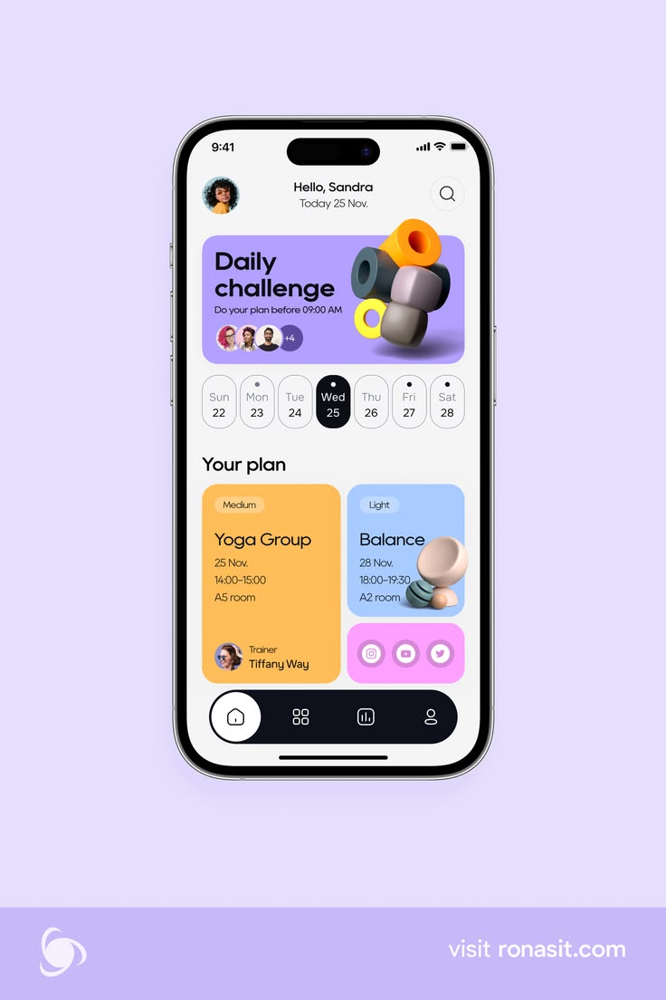

# Lilac Daily Challenge App with 3D Shapes

**Discipline:** app · **Design type:** Health app screens
**Tags:** fitness, lilac, 3d-shapes, pastel-cards, date-strip, yoga, phone

## What it is
A lilac page with a phone showing 'Hello, Sandra', a purple Daily challenge card with 3D orange, yellow and grey shapes, a pill date strip with Wed selected in black, Your plan cards (orange Yoga Group, blue Balance with 3D stones, pink social icons) and a pill tab bar, with a footer band and website.

## What it means
Bright 3D toy-like shapes and pastel cards make fitness feel playful, and the pill date strip is a friendly detail.

## Techniques
- 3D toy shapes as card illustrations
- Pill-shaped date strip with one black selected day
- Pastel card colours by class type
- Black pill tab bar with a white active button
- Lilac page and a darker footer band

## Best for
- Fitness and class booking apps
- Playful pastel UI
- 3D illustration in mobile cards

## Vocabulary
- **Date strip** — A row of day pills with the current day highlighted.
- **Toy shapes** — Chunky rounded 3D objects used as illustration.
- **Plan card** — A colour-coded card for a scheduled activity.
