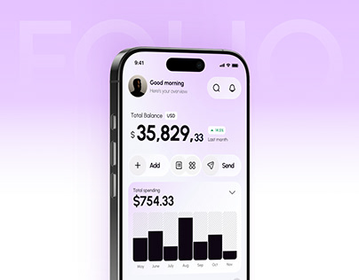

# Lilac Finance App with Ghost Lettering

**Discipline:** app · **Design type:** Device mockup scene
**Tags:** lilac, finance, balance, bar-chart, ghost-type, thumbnail, clean

## What it is
A cover with a phone showing a light finance home (large balance, action buttons, hatched bar chart) against a lilac-to-white gradient with huge faint 'FOLIO' lettering.

## What it means
Soft violet and white feel calm and modern. Hatched bars are a light touch of texture in an otherwise airy screen.

## Techniques
- Ghost brand name behind the phone
- Gradient fading to white toward the bottom
- Hatched bars with one solid highlighted bar
- Big balance figure with small cents
- Pill action buttons in a row

## Best for
- Personal finance apps
- Case-study covers
- Soft, friendly fintech branding

## Vocabulary
- **Hatched bar** — A bar filled with fine lines to look lighter than solid.
- **Action row** — A row of pill buttons for the main actions.
- **Fade to white** — A gradient ending in white to blend into the page.
