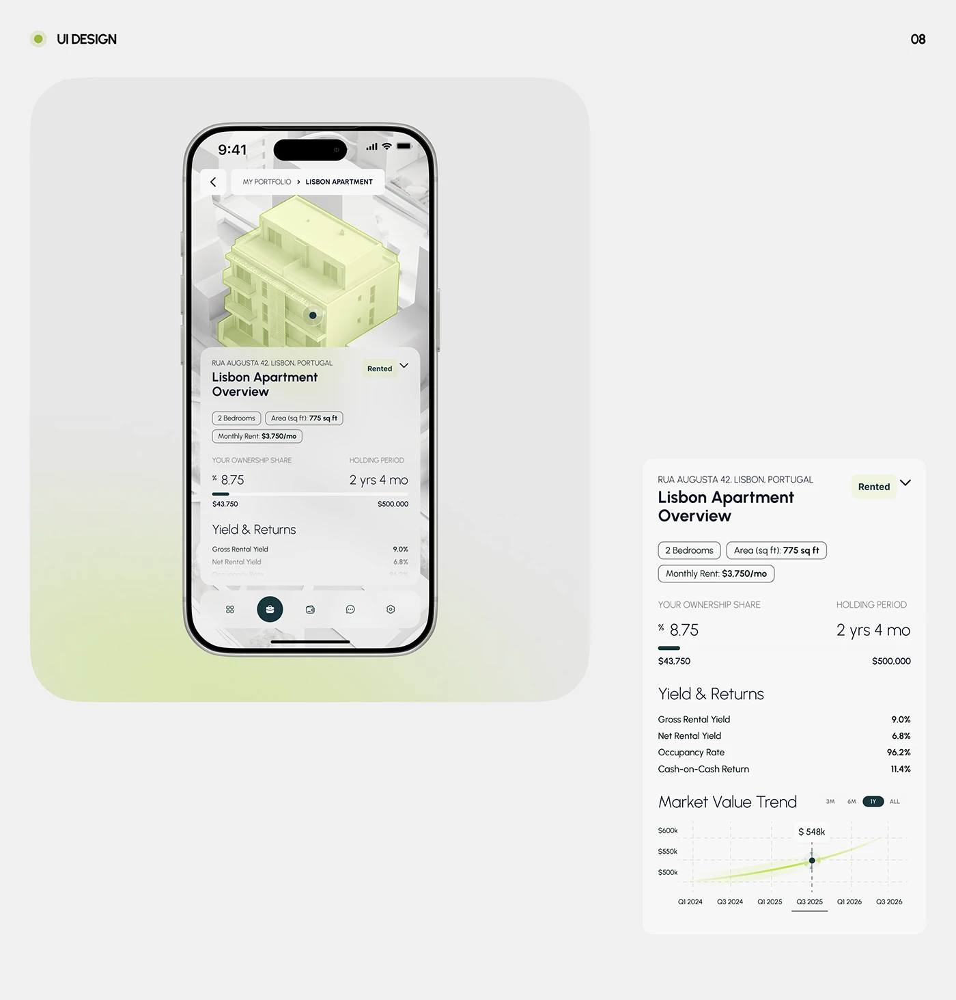

# Phone showing a lime-tinted 3D building over a frosted overview panel, with a flat detail card beside it

**Discipline:** app · **Design type:** Device mockup scene
**Tags:** real-estate, 3d-model, lime, frosted, phone, yield, chart, light-grey

## What it is
A light grey board 'UI Design 08' with a lime-green gradient rounded panel holding a phone whose top half is a lime-tinted 3D building on a white city model and a frosted sheet with the property overview, spec pills, ownership share, yield and returns; at the right, the same content flat with a market value line chart.

## What it means
Tangible and calm; a highlighted 3D building ties numbers to a place.

## Techniques
- Tint one 3D building lime in a white city.
- Slide a frosted info sheet over the model.
- Show the same content flat next to the phone.
- Use a glowing line chart.

## Best for
- Property investment apps
- 3D map interfaces
- Light lime fintech

## Vocabulary
- **Tinted model** — A 3D model coloured for emphasis.
- **Frosted sheet** — A blurred panel over a map.
- **Ownership share** — A stat showing the user's stake.
- **Flat card** — A component shown without a device.
