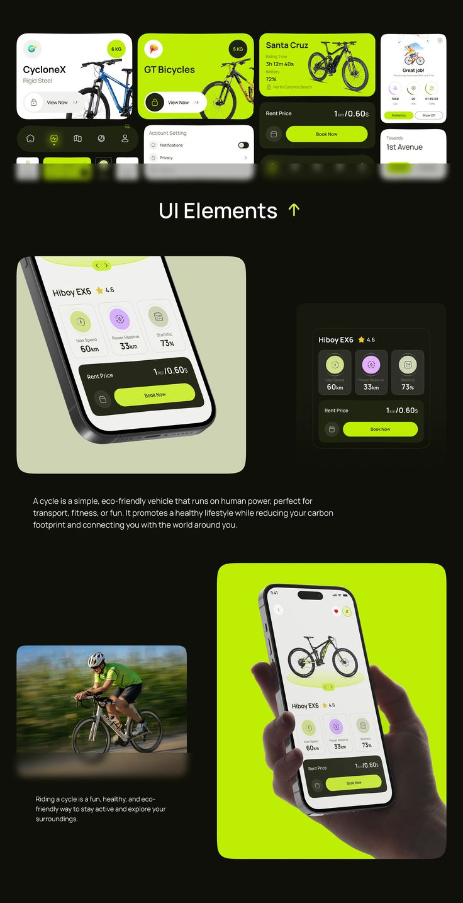

# Lime and Black Bike Rental UI Elements

**Discipline:** app · **Design type:** UI components
**Tags:** bike, rental, lime, black, components, cards, ui-elements

## What it is
A tall board with a header row of bicycle cards and nav pills on black, a heading 'UI Elements', a tilted phone detail with stat circles and Book Now, and a lime panel with a hand holding the phone plus a blurred cyclist photo.

## What it means
Neon lime on near-black is sporty and sustainable, and mixing tight component crops with lifestyle photos tells both the design and the story.

## Techniques
- Lime cards as bold accents among dark cards
- Circular stat icons in pastel lime, lilac and grey
- Extreme crop of the phone at an angle
- Light and dark versions of the same card side by side
- Motion-blurred lifestyle photo for energy

## Best for
- Mobility and rental apps
- UI element showcases in case studies
- Sports and eco brands

## Vocabulary
- **Component board** — A layout showing individual UI elements outside the full screens.
- **Stat circle** — A round icon with a number showing one metric.
- **Motion blur** — Streaking that implies movement in a photo.
