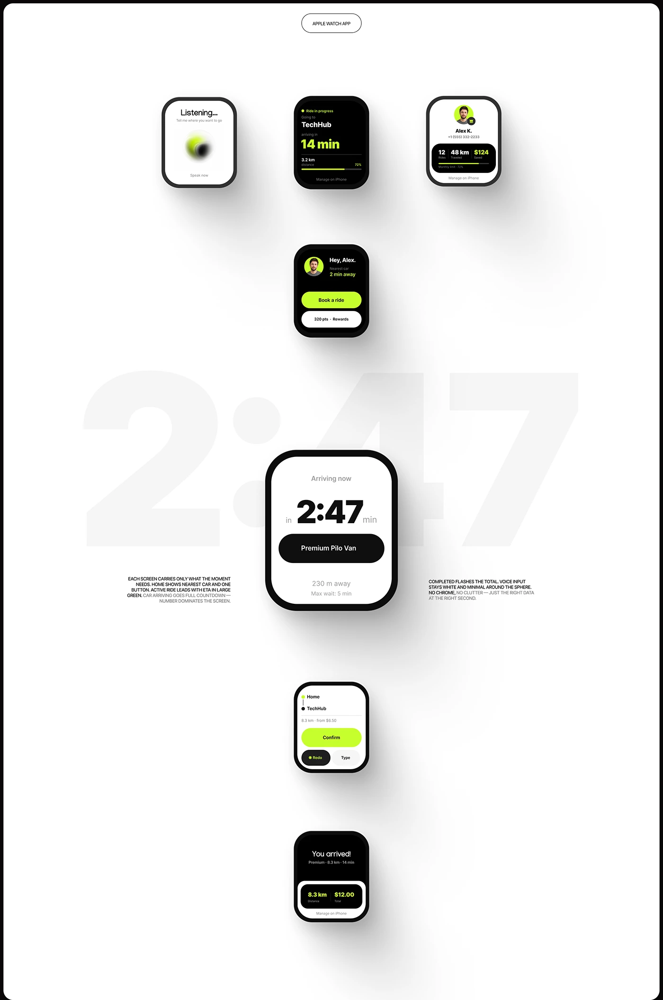

# Seven smartwatch screens in lime, black and white around a giant ghost 2:47 timer

**Discipline:** app · **Design type:** Wearable UI
**Tags:** smartwatch, wearable, lime, black, white, ghost-numerals, voice, rides

## What it is
A tall white board with an outlined 'Apple Watch App' pill and watch screens on soft shadows: a voice-listening lime blur, ride in progress, profile stats, a home with a lime Book a ride button, a large watch 'Arriving now 2:47 min' over huge faint numerals, a route confirm and an 'You arrived!' summary, with two small explanation texts.

## What it means
Precise and focused; each watch screen carries one datum.

## Techniques
- Show each state as a separate watch.
- Enlarge the hero screen over giant ghost numerals.
- Use lime for key data.
- Add tiny explanatory captions.

## Best for
- Wearable app flows
- Mobility products
- Minimal white boards

## Vocabulary
- **State sequence** — Screens showing each stage of a flow.
- **Ghost numerals** — Huge faint numbers behind content.
- **Listening orb** — A blurred sphere indicating voice input.
- **Glanceable data** — Info readable at a glance.
