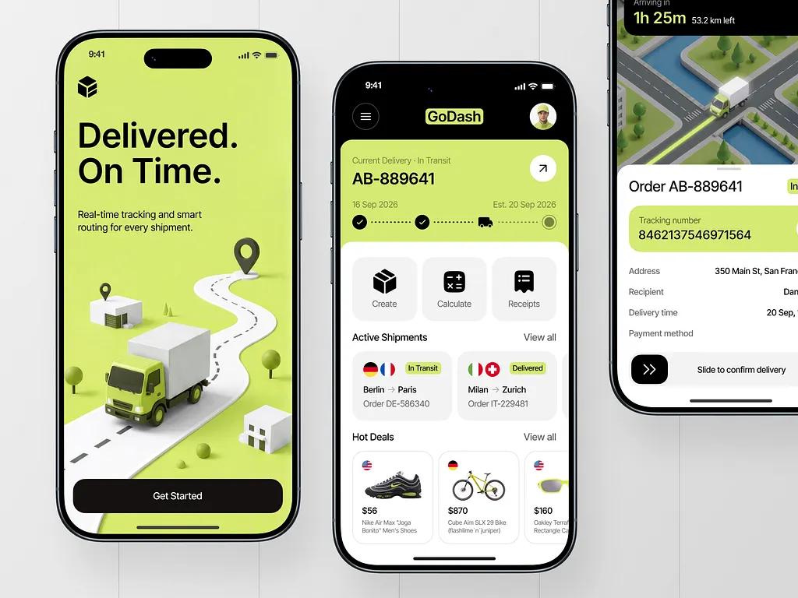

# Delivery app in lime and black: 3D truck on a winding road, shipment progress and map sheet

**Discipline:** app ·  · **Design style:** 3D & Surreal
**Tags:** delivery, lime, black, 3d-illustration, isometric, tracking, progress-steps, phones

## What it is
Three phones on light grey: a lime onboarding screen 'Delivered. On Time.' with a toy-like 3D truck on a curved road, a home with a lime tracking card, dotted step progress, action tiles and shipment cards with flags, and a partial map sheet with tracking number and a slide-to-confirm bar.

## What it means
Friendly and efficient; the toy truck makes logistics playful, lime signals speed.

## Techniques
- Illustrate the concept as a miniature 3D scene.
- Show progress as dotted steps with check circles.
- Use a lime header card on a white sheet.
- Use slide-to-confirm for the key action.

## Best for
- Logistics and delivery apps
- Onboarding with 3D illustration
- Lime and black brands

## Vocabulary
- **Isometric scene** — A miniature 3D world seen from above at an angle.
- **Step tracker** — Dotted line with checks for stages.
- **Slide to confirm** — A swipe control for an important action.
- **Shipment card** — A card summarising an order.
