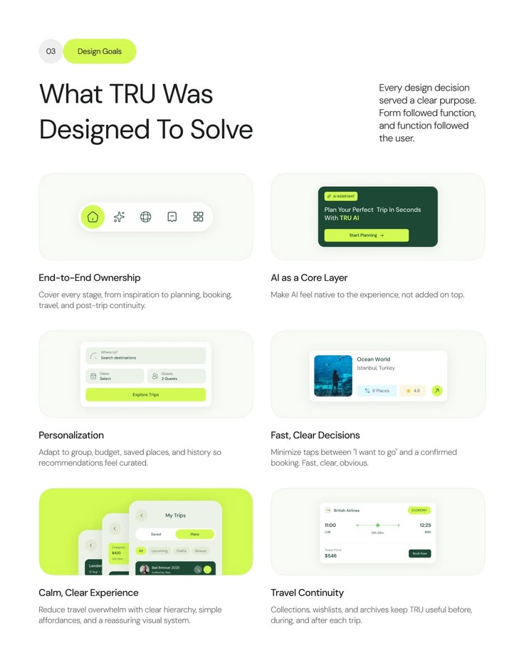

# Lime Design Goals Card Grid

**Discipline:** app ·  · **Design style:** Dark & Neon
**Tags:** design-goals, lime, green, cards, grid, travel, white

## What it is
A white slide, Design Goals, with a big title and six pale cards each showing a small UI fragment (tab bar, AI card, search form, place card, trip stack, flight ticket) with a title and description below.

## What it means
Each principle is paired with a tiny real UI piece, so goals feel concrete, and lime and dark green keep it fresh.

## Techniques
- Six-card grid pairing UI fragments with captions
- Numbered pill tag beside the title
- Lime highlight as the only bright colour
- Consistent card size and caption format
- Dark green for strong UI elements

## Best for
- Design rationale slides
- Case-study goals sections
- Explaining principles with visuals

## Vocabulary
- **UI fragment** — A cropped piece of interface used as illustration.
- **Goal card** — A card stating one design objective with a visual.
- **Caption pair** — A bold title and a grey description under an image.
