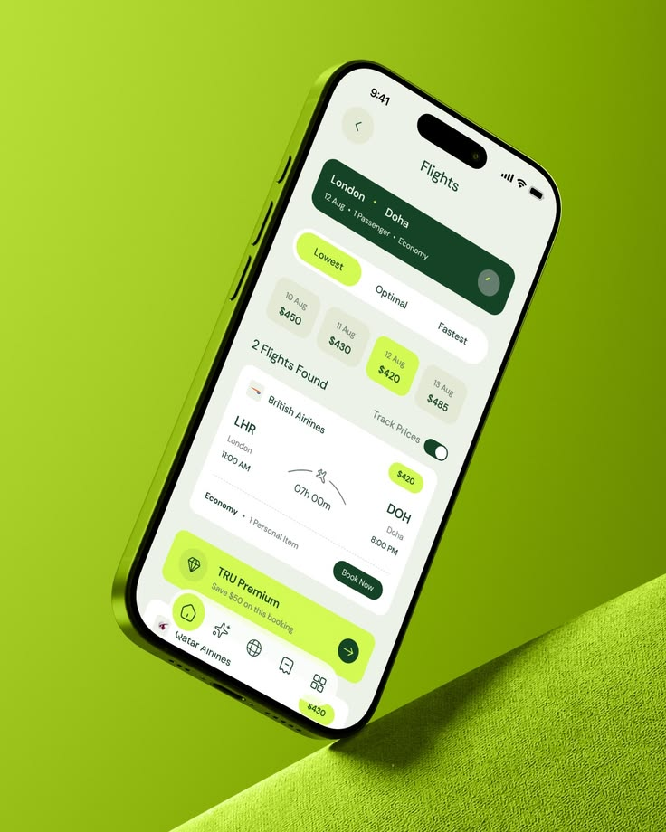

# Lime Flight Results Phone on Fabric

**Discipline:** app ·  · **Design style:** 3D & Surreal
**Tags:** lime, green, flights, tilted, fabric, pastel-cards, travel

## What it is
A lime-bezel phone balanced on a diagonal ledge of lime fabric, showing a flight results screen with a dark green summary card, price date chips, a flight card and a lime premium promo.

## What it means
A monochrome lime world with dark green anchors feels fresh and energetic. The balancing pose adds tension.

## Techniques
- Phone balancing on a corner for drama
- Tonal scene from bezel to background
- Selected date chip in lime, others neutral
- Dark green header card for contrast
- Toggle and premium banner as secondary accents

## Best for
- Travel and booking apps
- Vertical social and Pinterest presentations
- Colour-driven brand launches

## Vocabulary
- **Balance pose** — A device propped on an edge for a dynamic angle.
- **Selected chip** — A highlighted option among a row of choices.
- **Tonal bezel** — A device frame coloured to match the scene.
