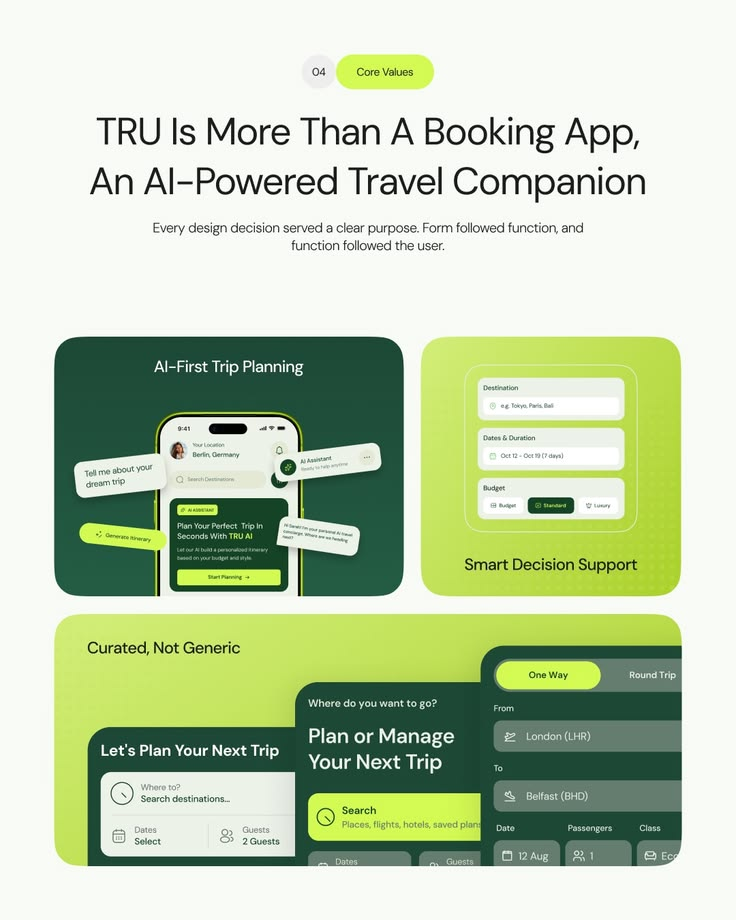

# Core Values Slide in Lime and Forest Green

**Discipline:** app · **Design type:** UX documentation
**Tags:** core-values, lime, green, cards, ai, travel, bento

## What it is
A pale slide with a numbered lime pill, a large headline 'TRU Is More Than A Booking App', and three feature cards: a dark green AI-first planning phone with floating chat bubbles, a lime card with stacked form fields, and a wide lime card with cropped booking forms.

## What it means
Lime and forest green feel fresh and travel-appropriate, and floating chat bubbles show the AI assistant in action.

## Techniques
- Floating chat bubbles around a phone
- Bento of dark and lime cards
- Cropped forms bleeding off the card edge
- Lime pill numbering the section
- Centred large headline with small subhead

## Best for
- Design value and rationale slides
- AI feature explanations
- Travel product case studies

## Vocabulary
- **Chat bubble float** — Message bubbles positioned around a device to explain AI.
- **Cropped form** — A form partly cut off by its container.
- **Section pill** — A small rounded label with the section number.
