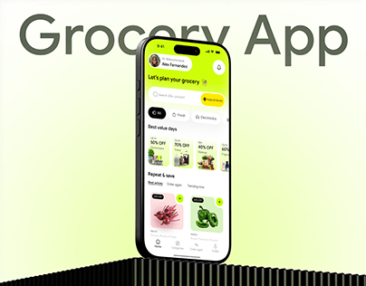

# Lime Grocery App on Ribbed Plinth

**Discipline:** app ·  · **Design style:** 3D & Surreal
**Tags:** grocery, lime, ghost-type, plinth, black, gradient, cover

## What it is
A cover with a phone showing a lime grocery home with offer cards and produce tiles, standing on a black ribbed plinth, with giant grey 'Grocery App' lettering behind on a lime-to-white gradient.

## What it means
Lime says fresh, and the black ribbed base gives a strong anchor.

## Techniques
- Ribbed black plinth as a base
- Ghost title cropped by the device
- Lime gradient background
- Discount cards in pastel colours
- Dark phone bezel for contrast

## Best for
- Grocery and food apps
- Fresh-toned brand covers
- Product-on-plinth staging

## Vocabulary
- **Ribbed plinth** — A fluted block used as a display base.
- **Ghost title** — Large faint text behind a subject.
- **Offer card** — A card showing a discount or deal.
