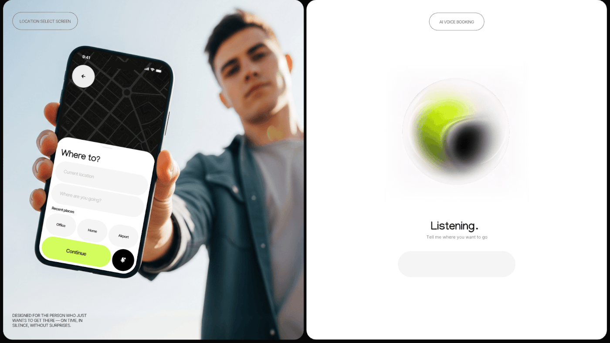

# Held-phone location screen next to a glowing voice orb

**Discipline:** app · **Design type:** Ride-hailing app
**Tags:** mobility, voice-ui, lime, white, orb, photography, two-panel, case-study

## What it is
Two panels: a low-angle photo of a person holding out a phone showing a dark map and 'Where to?' sheet with a lime Continue button; and a white panel with a soft glass orb of lime and black swirls labelled 'Listening.'

## What it means
Human and calm; the orb makes voice interaction feel alive, and the white panel contrasts with the energetic lime.

## Techniques
- Show the UI held towards the viewer for a direct, confident presentation.
- Design an AI-listening state as a single soft gradient orb on white.
- Use a minimal caption and empty input to keep the voice state uncluttered.
- Keep the accent colour consistent across photo and abstract panels.

## Best for
- Voice and AI assistant interfaces
- Mobility and booking flows
- Case study storytelling

## Vocabulary
- **Listening orb** — An animated shape signalling that a voice assistant is listening.
- **Held-out mockup** — A photo where a device is pushed towards the camera.
- **State screen** — A screen depicting one moment in a flow.
- **Glass orb** — A translucent sphere with blurred colour inside.
