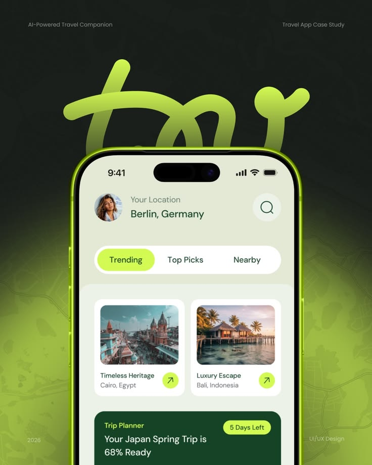

# Lime Glow Phone under Looping Script Logo

**Discipline:** app · **Design type:** Device mockup scene
**Tags:** lime, dark, logo, script, map, travel, glow

## What it is
A dark green poster with a giant lime looping script logo rising from behind a phone with a glowing lime rim, showing a travel home with tabs, destination cards and a trip planner card, over a faint map texture with labels in the corners.

## What it means
The huge glossy logo and lime glow make a strong brand poster, and corner captions frame it like a case-study cover.

## Techniques
- Giant glossy logo behind the device
- Lime rim light on the phone
- Faint map texture as a background
- Text captions in all four corners
- Pill tabs with one lime selected

## Best for
- Travel app case-study covers
- Dark lime brand posters
- Logo plus product hero images

## Vocabulary
- **Rim glow** — A coloured light around the edge of a device.
- **Logo hero** — A brand mark enlarged as the main graphic.
- **Map texture** — Faint map lines used as a background.
