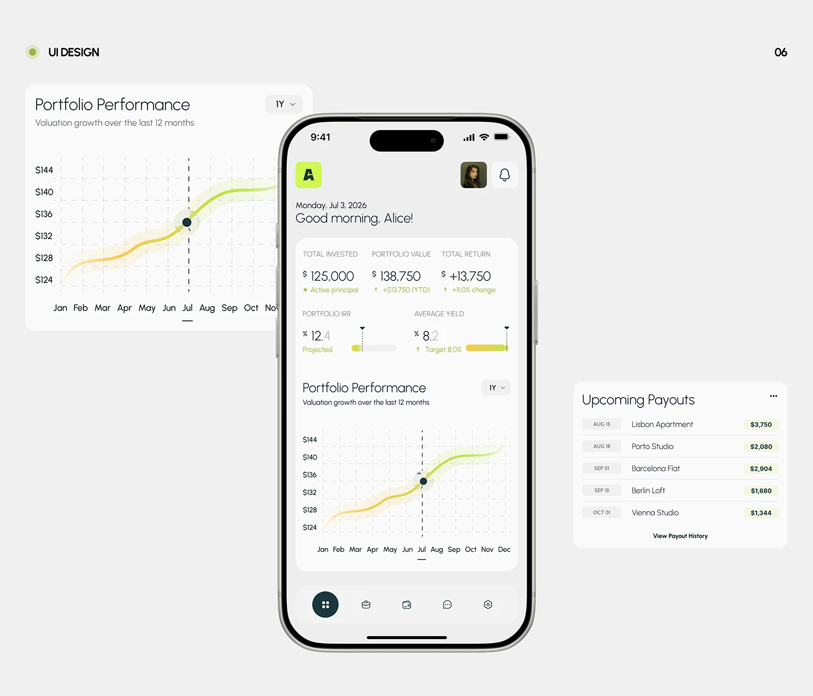

# Investment app with lime-yellow glow curve and quiet grey UI

**Discipline:** app · **Design type:** Fintech app screens
**Tags:** fintech, investing, lime, grey, line-chart, glow, phone-mockup, real-estate

## What it is
A light-grey board with a phone showing greeting, metrics for invested amount and returns, small progress bars and a performance chart with a glowing lime-to-yellow curve and a dashed vertical marker. Beside it float a chart card and an upcoming payouts list.

## What it means
Fresh, optimistic and precise; the glowing line makes growth the only colourful thing.

## Techniques
- Give the main chart line a soft blurred halo in a warm gradient.
- Use light numerals with a small greyed currency sign for elegant figures.
- Break a tall UI into floating cards outside the phone to explain components.
- Use a dark circular nav item as the only heavy element.

## Best for
- Investment and wealth apps
- Data-driven mobile UI
- Case study boards

## Vocabulary
- **Glow line** — A chart line with a soft luminous outline.
- **Exploded UI** — Components floated beside a device to explain them.
- **Marker line** — A dashed vertical rule showing a selected point.
- **Micro progress bar** — A thin bar showing status next to a metric.
