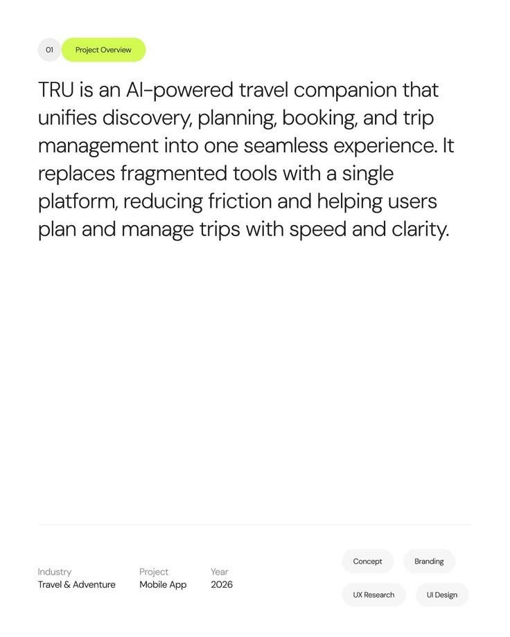

# Lime Project Overview with Metadata and Tags

**Discipline:** app · **Design type:** Case study intro slide
**Tags:** overview, white, lime, metadata, tags, large-text, minimal

## What it is
A white slide with a grey number chip and a lime 'Project Overview' pill, a very large paragraph describing an AI travel companion, a hairline rule and a footer with industry, project and year plus four grey tag pills.

## What it means
Huge light text and one lime pill feel clean and confident, and the footer holds the facts.

## Techniques
- Lime pill as the only colour
- Very large paragraph filling the upper half
- Empty middle space for calm
- Footer with labelled facts and pills
- Hairline separating content and footer

## Best for
- Project overview slides
- Travel and tech case studies
- Text-led introductions

## Vocabulary
- **Section pill** — A numbered rounded label marking a section.
- **Footer facts** — Small labelled details at the base of a slide.
- **Text-led slide** — A slide built mainly from a large paragraph.
