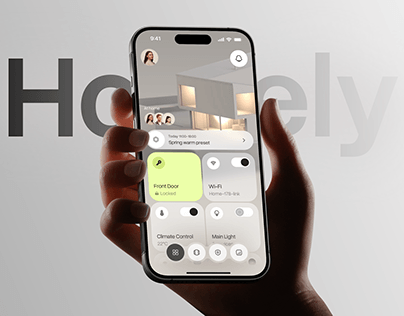

# Lime Smart Home Controls in Hand

**Discipline:** app ·  · **Design style:** Glassmorphism
**Tags:** smart-home, lime, glass, hand, ghost-type, grey, cover

## What it is
A grey gradient cover with giant faint 'Homely' behind a dark hand holding a phone showing a glassy home render with a lime front door card and grey control tiles for Wi-Fi, climate and light.

## What it means
One lime tile shows which control is active, and frosted grey tiles keep the rest calm.

## Techniques
- Ghost name cropped behind the hand
- Lime accent tile among grey glass tiles
- Photo render as a translucent header
- Hand from below at an angle
- Grey gradient background

## Best for
- Smart-home app covers
- Neutral scenes with a lime pop
- Glassmorphism UI

## Vocabulary
- **Glass tile** — A translucent blurred control tile.
- **Active tile** — The one tile coloured to show it is on.
- **Ghost name** — Oversized faint brand text behind a subject.
