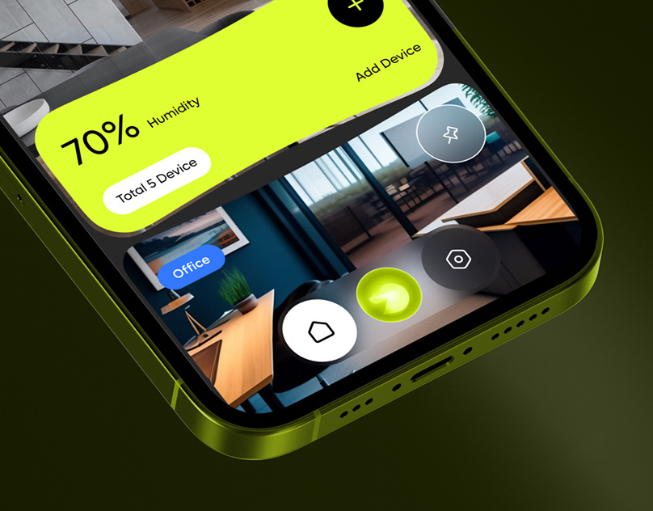

# Lime Smart-Home Phone Close-Up

**Discipline:** app · **Design type:** Device mockup scene
**Tags:** lime, smart-home, close-up, dark, organic-shapes, humidity, olive

## What it is
A macro crop of a lime-framed phone corner showing a wavy lime card (70% Humidity, Total 5 Device) over a photo of an office, with round control buttons.

## What it means
Extreme cropping and a neon lime bezel feel bold and energetic. The organic card shape softens a technical topic.

## Techniques
- Extreme close-up crop of the device corner
- Lime bezel matched to lime UI card
- Wavy blob-shaped card contour
- Photo cards behind translucent controls
- Circular glass buttons in different tones

## Best for
- Smart-home and IoT apps
- Bold dark presentations
- Macro app teasers

## Vocabulary
- **Macro crop** — A tight crop that fills the frame with a small part of the subject.
- **Blob card** — A card with soft irregular edges.
- **Glass button** — A translucent round control.
