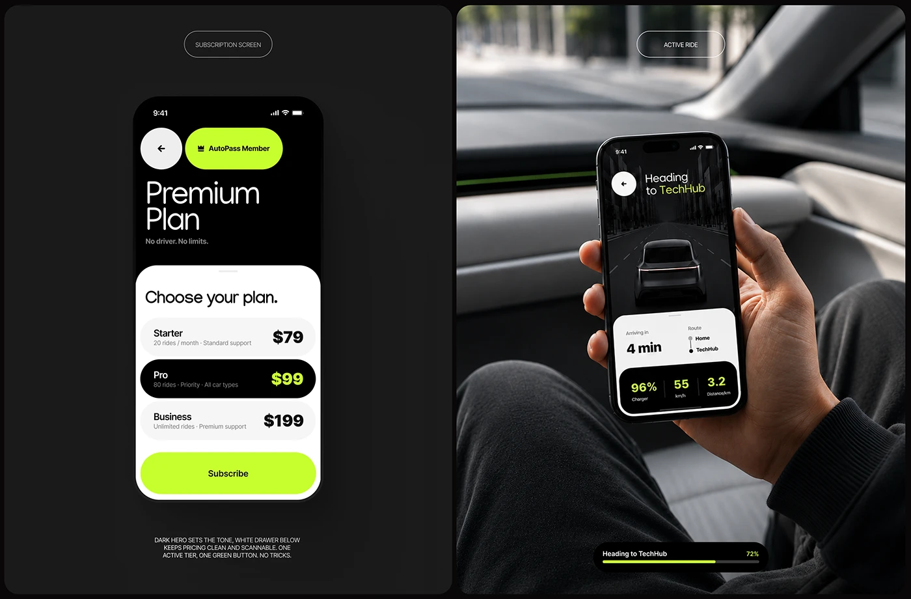

# Black-and-white pricing drawer with lime button beside an in-car hand-held active ride screen

**Discipline:** app ·  · **Design style:** Neo-Brutalist
**Tags:** subscription, pricing, lime, black, white, in-car, photography, split

## What it is
Two dark panels: left a phone with a black header 'Premium Plan' and a white drawer listing three plans with the middle plan black with lime price, and a wide lime Subscribe button; right a photo of a hand holding a phone inside a car with a dark road screen, a white ETA sheet with lime stats and a lime progress pill.

## What it means
Confident and clear; one active tier and one lime button make the choice simple.

## Techniques
- Split screen into black hero and white drawer.
- Invert the selected plan to black.
- Use one lime CTA.
- Show the app in its real context (inside a car).

## Best for
- Subscription and pricing screens
- Mobility apps
- Black and lime brands

## Vocabulary
- **Pricing drawer** — A white sheet listing plans.
- **Inverted selection** — The selected item shown black.
- **Context photo** — A device photographed in its use setting.
- **Progress pill** — A small bar showing trip progress.
