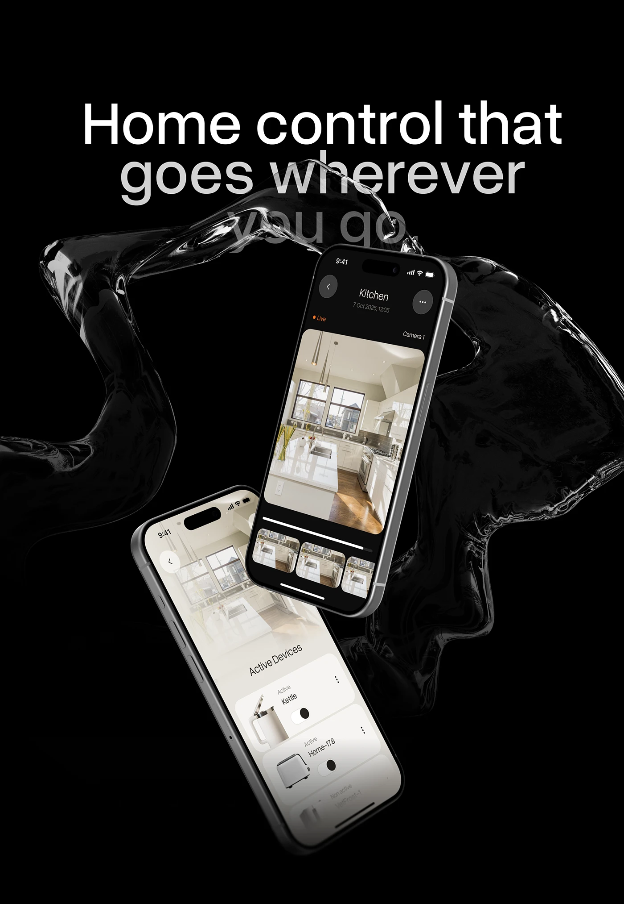

# Liquid Ribbon Around Home-Control Phones

**Discipline:** app ·  · **Design style:** Glassmorphism
**Tags:** black, liquid, glass, smart-home, floating, headline, poster

## What it is
A tall black poster with a large headline 'Home control that goes wherever you go' partly fading into a translucent black liquid ribbon looping around two floating phones (a dark camera feed and a cream device list).

## What it means
The liquid ribbon suggests flow and connection, and the fading headline blends type with imagery for a dramatic effect.

## Techniques
- Headline that fades progressively along its second line
- Glassy liquid 3D object encircling the devices
- Two phones at opposing angles in a dark and a light UI
- Pure black background so highlights glow
- Simple sentence-case sans headline

## Best for
- Smart-home and connected product launches
- Vertical hero posters
- Premium dark presentations

## Vocabulary
- **Fading headline** — Text whose lines lose opacity as they descend.
- **Liquid 3D form** — A rendered flowing translucent shape.
- **Opposing tilt** — Two objects rotated in different directions for dynamism.
